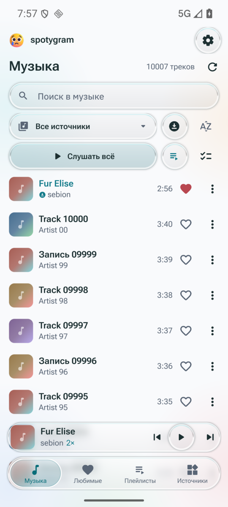

<strong>English</strong> · <a href="README.ru.md">Русский</a>

# spotygram rust

A music player for Telegram chats, profile music and local files. This is the
personal **Rust rewrite**, developed on `rust-rewrite` for Android, Windows, Linux
and macOS. The shared interface uses Makepad; desktop playback uses libmpv and
Android uses Media3. Telegram connects directly through TDLib.

**This is an experimental app with a separate local profile.** The stable Kotlin
app remains on [`main`](https://github.com/Krablante/spotygram/tree/main).
Rust previews use `rust-v…` prerelease tags and never become GitHub's latest stable
release. Desktop packages contain no Java runtime.

[Download the Rust preview](https://github.com/Krablante/spotygram/releases/tag/rust-v0.2.4)
· [User guide](docs/usage.md) · [Build from source](docs/build.md)
· [Verification and limits](docs/verification.md)

 

## Install and start

| Device | Preview package | Requirements |
| --- | --- | --- |
| Android ARM64 | `spotygram-rust-…-arm64.apk` | Android 8.0+, 64-bit ARM, OpenGL ES 3 |
| Android x86-64 | `spotygram-rust-…-x86_64.apk` | Android 8.0+, x86-64, OpenGL ES 3 |
| Windows | `spotygram-rust-…-windows-x64.zip` | Windows 10+, x86-64, Direct3D 11 GPU (feature level 11.0) |
| Linux | `spotygram-rust-…-linux-x64.tar.gz` | Ubuntu 24.04+ or a compatible graphical Linux environment, x86-64 |
| macOS Apple Silicon | `spotygram-rust-…-macos-arm64.zip` | macOS 14+ |
| macOS Intel | `spotygram-rust-…-macos-x64.zip` | macOS 14+ |

Install the APK alongside stable Spotygram. On a computer, extract the **whole
archive** and launch `spotygram-rust.exe`, the Linux `spotygram-rust` launcher, or
`spotygram rust.app`. Keep the adjacent native libraries and resources. Linux
Telegram sign-in needs an unlocked Secret Service key store.

Windows previews have no Authenticode publisher certificate. macOS previews are
ad hoc signed without notarization; the first launch may require **System
Settings → Privacy & Security → Open Anyway**.

Open **Settings → Storage → Import audio files** to listen without an account. Desktop
also accepts dropped files and **Ctrl/⌘+O**. For Telegram music, connect your
account in **Settings → Telegram**, then choose chats or profiles under **Sources**. Published
packages already include the Telegram application API configuration.

The preview has a separate Telegram session, database and import directory.
**Cloud playlists, favorites, connected sources and library settings are shared
with stable Spotygram when you sign in to the same account.** Editing those
items in either version changes the same synced library. Queue, positions,
volume and speed remain local to each app.

## While you listen

Search and sort the library, filter its sources, save favorites and make
playlists. The catalog reads pages from SQLite and draws visible rows instead
of retaining every song's metadata in the interface. Covers decode for their
displayed size. The 0.2 interface follows the Kotlin layouts: compact rows,
Roboto typography, original header stickers, vector icons, a shared glass
navigation capsule and moving tab lens. English and Russian and both light and
dark appearances are available.

Settings uses a dedicated screen with General, Player, Storage and Telegram
sections, fixed navigation and independent scroll positions. Wide windows place
the sections at the left. Theme, language and common preferences change directly
in the selected section.

The small player opens the full player and queue. Playback supports normal,
reverse, shuffle and random order, three repeat modes, and speed from **0.3× to
4×** with pitch correction. Long recordings have local bookmarks with an
adjustable duration threshold. Desktop also has volume, mute and system media
controls; Android has a foreground media service and lock-screen controls.

Use a song's menu to download it, add it to a playlist or Telegram profile, or
send it to a chat. Sending requires confirmation and rechecks the recipient's
permissions. The recipient chooser includes chat folders, forum topics, pinned
recipients and recent successful recipients. Its sender/caption summary stays
beside Send.
Queue rows have move-up and remove buttons; playlist recordings have **Move up /
Move down** in their menus.

Imports are copied into app-owned storage. Explicit downloads stay saved.
**Do not keep played tracks** allows older temporary Telegram playback copies
to be removed. Deleting an imported copy requires confirmation and preserves
the original external file.

Closing an active desktop player minimizes it. **Ctrl/⌘+Q**, or **Quit** in
Settings, saves state and closes the app. **Esc** closes the current sheet or
player. Preview updates are checked manually in Settings and open the Rust
prerelease page; they do not use the stable installer/update channel.

## Development

Start with [the build guide](docs/build.md) and [architecture](docs/architecture.md).
Generated state, native dependencies and release packages live outside source
under `SPOTYGRAM_STATE`. The UI and library logic are Rust; Android's small Java
layer owns the activity, file picker, Keystore and Media3 service.

Performance claims and platform coverage belong in [verification](docs/verification.md).
A smaller runtime does not by itself prove lower battery use or smoother frames
on a particular device. This preview needs device testing before replacing the
stable app.

[Third-party software](docs/third-party.md) · [MIT license](LICENSE)
