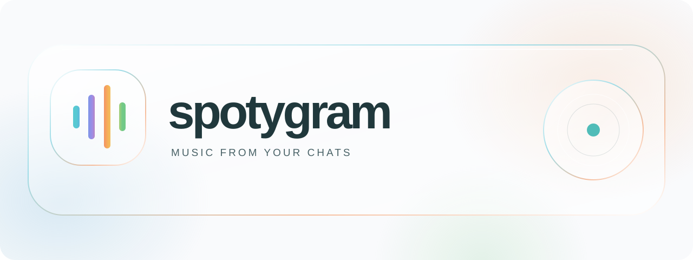
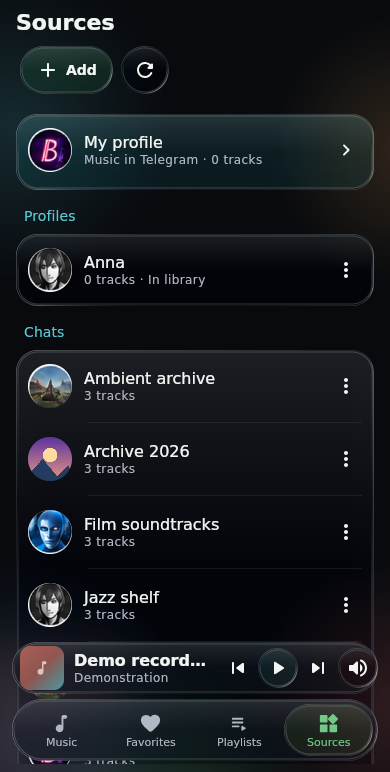
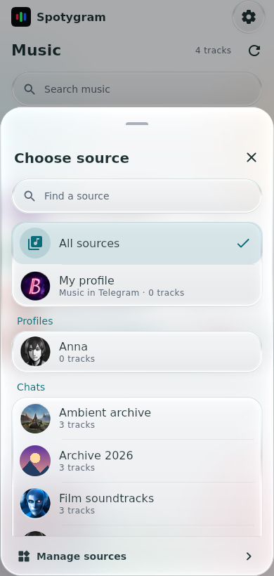
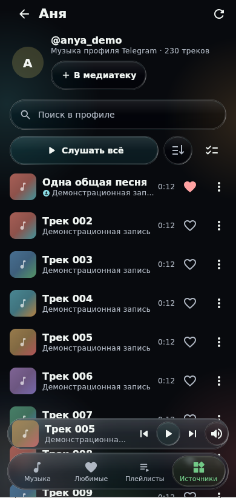
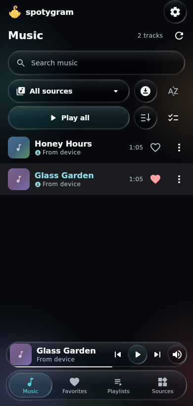
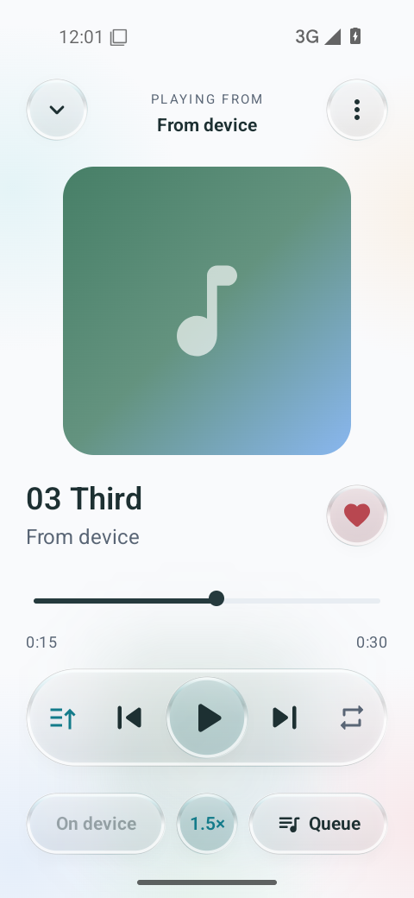
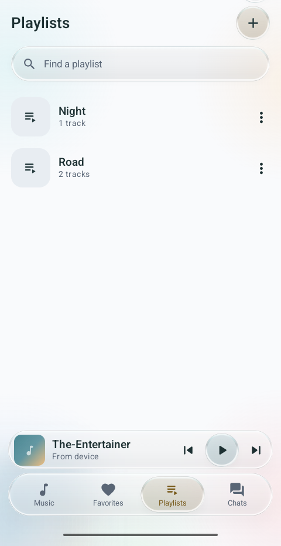
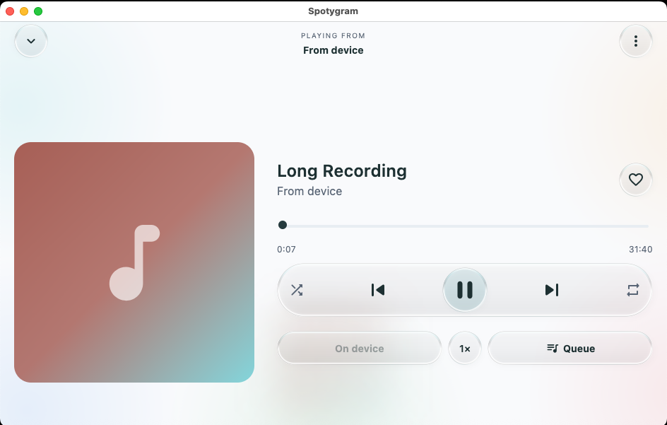

  <strong>English</strong> · <a href="README.ru.md">Русский</a>

  

  <strong>A music player for Telegram chats, profile music and local files.</strong> 
  Android · Windows · Linux · macOS

  <a href="https://github.com/Krablante/spotygram/releases/latest"><strong>Download Spotygram</strong></a> ·
  <a href="docs/usage.md">User guide</a> ·
  <a href="docs/README.md">Documentation</a>

## From a chat to a music library

A song in Saved Messages, an album in a channel, a few recordings from a friend.
Telegram holds the files, but finding the next song should not mean scrolling
through a conversation.

Spotygram plays that collection on **Android, Windows, Linux and macOS**. Choose the chats you want
to listen to, and their audio appears in one searchable library. Save favorites,
make playlists, download music for later. You can also import files from your
device and use the player without connecting Telegram. All versions share the
same screens, glass material, library and playback rules.

**Sources** keeps your Telegram profile at the top, with connected profiles and
chats in shared glass panels below. Their avatars also appear in the searchable
source menu in Music. Open a profile to listen to its pinned music, then choose **Add to library**
if you want all its songs in your collection. A heart or playlist saves an individual
song without connecting the profile. Other people’s music follows Telegram’s privacy settings.

  
  &nbsp;
  
  &nbsp;
  

These screens show demonstration sources and recordings in the shared desktop interface.

Sign in to the same Telegram account on another device to restore your playlists,
favorites, selected chats and profiles, and library settings automatically. Each device keeps its own
queue, last track and listening positions, including long-recording bookmarks. Spotygram
keeps its library documents in a private, muted channel in your Telegram archive.

  
  &nbsp;
  
  &nbsp;
  

The library, player and playlist screenshots above were captured in 0.18.0;
the fourth tab is now Sources.

## Put it on your phone

Download **`spotygram-…-arm64.apk`** from the [latest release](https://github.com/Krablante/spotygram/releases/latest).
It requires **Android 8.0 or newer** and a 64-bit ARM device. The separate
`x86_64` APK is for x86-64 Android environments; there is no 32-bit ARM build.

Install the APK, connect your Telegram account, then open **Sources**.
Your profile is ready to open. **Add → Chats** selects Saved Messages, groups or channels;
**Add → Profiles** finds people by name, @username or a t.me link. You do not need
developer API keys to use the published APK. Prefer local files? Skip sign-in
and choose **Settings → Import audio files**.

Install future APKs over the existing app to keep your library. Spotygram checks
for new releases when you open it, at most once a day. It stays quiet unless
there is an update. You can dismiss that version's reminder, turn automatic
checks off, or check manually in Settings. **Download and install** is available
in both the update banner and Settings: it downloads the right APK, verifies it
and opens Android's installation confirmation. There is no need to find the
file on GitHub. Nothing downloads until you choose it.

## Put it on your computer

Choose the installer for your computer from the same [release](https://github.com/Krablante/spotygram/releases/latest):

| System | Download | Requirements |
| --- | --- | --- |
| Windows | `spotygram-…-windows-x64.exe` | Windows 10+ on x86-64 |
| Linux | `spotygram-…-linux-x64.deb` | Ubuntu 24.04+, x86-64, a graphical desktop and Secret Service for Telegram sign-in |
| macOS, Apple Silicon | `spotygram-…-macos-arm64.dmg` | macOS 14+ |
| macOS, Intel | `spotygram-…-macos-x64.dmg` | macOS 14+ |

- **Windows:** open the EXE and follow the installation wizard. It installs for your user,
  adds a Start menu shortcut and an optional desktop shortcut, and appears in **Settings → Apps** for removal.
  For an existing MSI installation (0.15.2–0.15.4), download and run this EXE once;
  it replaces the old installer registration and keeps your library and sign-in.
- **macOS:** open the DMG and drag Spotygram onto Applications. Eject the disk image,
  then open the installed app from Applications.
- **Linux:** open the DEB with your software installer, or run `sudo apt install ./spotygram-…-linux-x64.deb`
  with the downloaded file's actual name. Launch Spotygram from the applications menu.

Java, TDLib and the audio engine are included. Windows packages do not have an
Authenticode publisher certificate. macOS builds are ad hoc signed, without Apple
notarization; if macOS blocks the first launch, use **System Settings → Privacy &
Security → Open Anyway**.

ZIP archives and the Linux TAR.GZ remain available for portable use; the Linux
archive supports other distributions with glibc 2.35+. Extract the **whole archive**
and open its launcher. An existing portable library is also available to the
installer version under the same OS user; quit the old copy before switching.

Sign in using your phone number or the QR code, or import local files.
**Ctrl/⌘+O** opens the import picker; **Esc** closes the current sheet or player.
Closing the window keeps active playback or downloads running in the tray, or
minimizes the window when a tray is unavailable. **Ctrl/⌘+Q** quits.

Desktop updates use the same **Download and install** action. Installed copies
verify the package and its release signature, then offer to close Spotygram and
open the system installer. Complete installation and launch from your applications.
Portable copies update their writable application folder and reopen automatically.
Your library and Telegram session are stored separately from the program.

  

## While you listen

Playback continues in the background, with Android lock-screen controls and
desktop system media controls.
The small player opens the full player and queue. Long-press a song to select
several tracks for a playlist or download; drag tracks to reorder a playlist.

Choose **in order**, **in reverse order**, **shuffle**, or **absolute random**
from the order button in the player, above a song list, or in a song's menu.
Reverse follows the list upward; Play all starts at its last available song.
Changing order keeps the current song and position. Shuffle plays a pass without
repeats. The dice mode draws each next song
independently, so the same song can come up twice in a row. It keeps going
until you stop it; Previous retraces your recent listening history.

Desktop has a **0–100% volume slider** beneath the full player's controls.
The mini-player's speaker button opens a compact slider. Click the speaker inside
the slider to mute or restore the previous level; the mouse wheel adjusts volume.
Volume, mute, order, repeat and speed stay on each device.

The round speed button below Play opens a **0.3×–4×** slider, fine adjustment
and quick choices. Speed changes keep the original pitch and carry across songs
and app restarts. Tap **1×** to return to normal; the mini-player shows altered speed.

Recordings **30 minutes or longer** remember where you stopped, including after
switching tracks or reopening the app. Change the duration threshold or turn this
off in Settings. Finished recordings start over.

Downloaded songs are available under **On device**. The interface comes in
English and Russian, with light and dark appearances. The initial appearance
follows the system until you choose one in Settings.

Glass controls reflect the artwork and the library scrolling beneath them.
Light and dark share the same layout and material; wide screens use side
navigation and a player with separate artwork and control columns. Full
refraction works on desktop and Android 13+; older supported Android versions use simpler glass.

Repeated recordings are hidden by default. Turn **Settings → Hide duplicates**
off to see separate entries again. This only changes the lists; nothing is deleted.

Prefer not to keep every song? Turn on **Do not keep played tracks** in Settings.
The player keeps a temporary working set and removes older playback copies.
Existing files, explicit downloads and imports stay saved; **Save on device**
keeps a temporary copy. The mode is off by default and still uses temporary
disk space. Returning to older songs may require another download.

## Your files and your account

Audio files and the Telegram session live on each device. Library data also syncs
through your Telegram account using Telegram's ordinary cloud protection. Spotygram has no
backend, separate registration or analytics. It connects directly to Telegram;
release checks contact GitHub, which sees your connection IP and app version.

A Telegram sign-in grants a **full account session**. Choosing source chats
limits what Spotygram indexes, not what that session is permitted to access.
You can revoke it from Telegram's device settings.

**Clear music cache also removes Telegram songs you explicitly downloaded.**
Imported files, favorites, playlists and sign-in remain. If the original
message or profile audio is no longer accessible, a deleted local copy may not be recoverable.
Uninstalling the Android app removes its local music and settings. Deleting the
desktop application folder leaves its separate user data in place. Synced library
data returns after sign-in; imported audio files need their own backup.

## Under the cover

One Kotlin/Compose visual system and shared application code. TDLib handles
Telegram; Media3 on Android and libmpv on desktop decode audio through the same
file reader. SQLite stores the library. There is no web view or streaming proxy.
One shared queue supplies a small playback window while retaining the full list
inside the app. Desktop uses a bundled, limited Java runtime.

For the details, start with [architecture](docs/architecture.md) or
[building from source](docs/build.md). The [documentation index](docs/README.md)
links both language editions.

This is an early public release. Secret chats, voice notes and automatic transfer
of imported audio files are not supported. The [verification record](docs/verification.md) separates
observed behavior from untested cases, including physical-device and
authenticated Telegram checks. Screenshots show the real app with local
demonstration recordings, not music bundled with the APK.

## License

[MIT](LICENSE). Dependencies retain [their own licenses](docs/third-party.md).
Spotygram is an unofficial app using the Telegram API and is not affiliated
with Telegram or Spotify.
