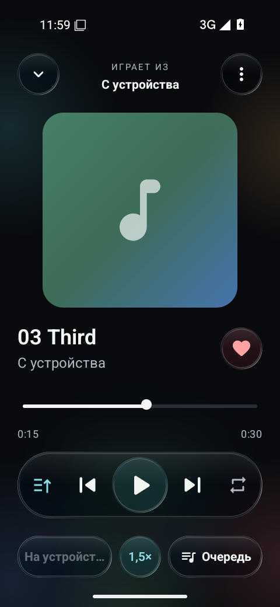

  <a href="README.md">English</a> · <strong>Русский</strong>

  

  <strong>Музыкальный плеер для твоих чатов Telegram и локальных файлов.</strong> 
  Android · Windows · Linux · macOS

  <a href="https://github.com/Krablante/spotygram/releases/latest"><strong>Скачать Spotygram</strong></a> ·
  <a href="docs/usage.ru.md">Как пользоваться</a> ·
  <a href="docs/README.ru.md">Документация</a>

## Из переписки в музыкальную библиотеку

Песня в «Избранном», альбом в канале, несколько записей от друга. Файлы уже
в Telegram, но листать переписку ради следующей песни не хочется.

Spotygram играет эту коллекцию на **Android, Windows, Linux и macOS**. Выбираешь чаты, которые хочешь
слушать, и аудио из них появляется в общей библиотеке с поиском. Можно
сохранять любимые песни, собирать плейлисты и скачивать музыку на потом.
Локальные файлы тоже подойдут: для них подключать Telegram вообще не нужно.
Все версии используют одни экраны, стеклянный материал, библиотеку и правила воспроизведения.

Войди в тот же Telegram-аккаунт на другом устройстве: плейлисты, любимые песни,
выбранные чаты, настройки и позиции прослушивания восстановятся автоматически.
Документы библиотеки хранятся в приватном канале с отключёнными уведомлениями
в архиве Telegram.

  
  &nbsp;
  
  &nbsp;
  

## Установить на телефон

Скачай **`spotygram-…-arm64.apk`** из [последнего релиза](https://github.com/Krablante/spotygram/releases/latest).
Нужны **Android 8.0 или новее** и устройство с 64-битным ARM-процессором.
Отдельный APK `x86_64` предназначен для Android на x86-64; сборки для 32-битного ARM нет.

Установи APK, войди в Telegram и открой **Чаты → Добавить чаты**. Выбери
«Избранное», группы или каналы с музыкой. Для готового APK не нужны
API-ключи разработчика. Если хочешь слушать только свои файлы, пропусти вход
и открой **Настройки → Добавить файлы с устройства**.

Следующие APK устанавливай поверх приложения, чтобы сохранить библиотеку.
Spotygram проверяет новые релизы при открытии, не чаще раза в сутки,
и молчит, пока обновления нет. Напоминание о конкретной версии можно закрыть,
автоматику — выключить, а проверку — запустить вручную в настройках.
Кнопка **Скачать и установить** есть и в предложении обновления, и в настройках:
она скачивает подходящий APK, проверяет его и открывает подтверждение Android.
Искать файл на GitHub не нужно. Без нажатия ничего не скачивается.

## Установить на компьютер

Выбери установщик для своего компьютера в том же [релизе](https://github.com/Krablante/spotygram/releases/latest):

| Система | Файл | Требования |
| --- | --- | --- |
| Windows | `spotygram-…-windows-x64.exe` | Windows 10+ на x86-64 |
| Linux | `spotygram-…-linux-x64.deb` | Ubuntu 24.04+, x86-64, графический рабочий стол и Secret Service для входа в Telegram |
| macOS, Apple Silicon | `spotygram-…-macos-arm64.dmg` | macOS 14+ |
| macOS, Intel | `spotygram-…-macos-x64.dmg` | macOS 14+ |

- **Windows:** открой EXE и пройди мастер установки. Приложение устанавливается
  для твоего пользователя, получает ярлык в меню «Пуск» и необязательный ярлык
  на рабочем столе, появляется в **Настройки → Приложения** для удаления.
  Если уже установлен MSI (0.15.2–0.15.4), один раз скачай и запусти этот EXE:
  он заменит регистрацию старого установщика, сохранив библиотеку и вход.
- **macOS:** открой DMG и перетащи Spotygram на Applications. Извлеки образ диска,
  затем открой установленное приложение из Applications.
- **Linux:** открой DEB через установщик программ или выполни
  `sudo apt install ./spotygram-…-linux-x64.deb`, подставив точное имя скачанного файла.
  Запускай Spotygram из меню приложений.

Java, TDLib и звуковой движок уже включены. У Windows-пакета нет сертификата
издателя Authenticode. macOS использует ad hoc подпись без нотариализации Apple;
если система блокирует первый запуск, открой **Системные настройки →
Конфиденциальность и безопасность → Всё равно открыть**.

ZIP и Linux TAR.GZ остаются для переносного запуска; архив Linux поддерживает
и другие дистрибутивы с glibc 2.35+. Распакуй **весь архив** и открой launcher.
Установленная версия видит прежнюю переносную библиотеку того же пользователя ОС.
Перед переходом заверши старую копию приложения.

Войти можно по номеру телефона или QR-коду; локальные файлы работают без входа.
**Ctrl/⌘+O** открывает выбор файлов, **Esc** закрывает панель или плеер.
Закрытие окна оставляет активное воспроизведение и загрузки в трее, а при
отсутствии трея сворачивает окно. **Ctrl/⌘+Q** завершает приложение.

Обновление на компьютере запускается той же кнопкой **Скачать и установить**.
Установленная копия проверяет пакет и подпись релиза, затем предлагает закрыть
Spotygram и открыть системный установщик. Заверши установку и запусти приложение
из списка программ. Переносная копия обновляет свою доступную для записи папку
и открывается автоматически. Библиотека и сессия Telegram хранятся отдельно от программы.

  

## Во время прослушивания

Музыка играет в фоне, управление доступно на экране блокировки Android
и через системные медиакнопки компьютера. Нижняя
панель открывает полный плеер и очередь. Зажми песню, чтобы выбрать
несколько треков для плейлиста или скачивания; порядок в плейлисте
меняется перетаскиванием.

Кнопка порядка переключает **по порядку**, **перемешивание** и **абсолютный
рандом**. Перемешивание проходит подборку без повторов. Режим с кубиком
выбирает каждую следующую песню независимо: одна и та же может выпасть
дважды подряд. Он играет, пока не остановишь; кнопка «Назад» возвращает
к недавно прослушанным песням.

Круглая кнопка скорости под Play открывает ползунок **0,3×–4×**, точную
подстройку и быстрые значения. Высота голоса сохраняется, а выбранный темп
остаётся при переключении песен и перезапуске приложения. **1×** возвращает
обычную скорость; мини-плеер показывает изменённый темп.

Записи длительностью **от 30 минут** запоминают место остановки — в том числе
после смены трека и повторного входа. Порог можно изменить в настройках или
выключить сохранение. Дослушанные записи начинаются заново.

Не хочешь сохранять каждую песню? Включи **Не сохранять прослушанное**
в настройках. Плеер оставляет временный рабочий набор и удаляет более старые
копии. Старые файлы, явные скачивания и импорт сохраняются; кнопка
**Сохранить на устройстве** оставляет временную копию. По умолчанию режим
выключен. Временное место на диске всё равно нужно, а для возврата к старым
песням может потребоваться повторная загрузка.

Сохранённые песни доступны в разделе **На устройстве**. В интерфейсе есть
русский и английский языки, светлое и тёмное оформление. До выбора в настройках
оформление следует настройке системы.

Стеклянные элементы отражают обложки и прокручиваемую под ними библиотеку.
Светлая и тёмная темы используют одну геометрию и материал; на широком экране
навигация переходит в боковую панель, а плеер разделяет обложку и управление.
Полное преломление доступно на компьютерах и Android 13+; на более ранних
поддерживаемых версиях Android стекло проще.

Повторяющиеся записи скрываются по умолчанию. Выключи **Настройки → Скрывать
дубли**, чтобы снова видеть отдельные записи. Это меняет только списки,
ничего не удаляя.

## Твои файлы и аккаунт

Аудиофайлы и сессия Telegram хранятся на каждом устройстве. Данные библиотеки
также синхронизируются через аккаунт с обычной облачной защитой Telegram. У Spotygram нет
своего сервера, отдельной регистрации и аналитики. Приложение подключается
напрямую к Telegram; за обновлениями обращается к GitHub, которому видны
IP подключения и версия приложения.

Вход в Telegram создаёт **полноценную сессию аккаунта**. Выбор чатов ограничивает
музыкальную библиотеку Spotygram, а не права этой сессии. Её можно завершить
в разделе устройств официального Telegram.

**Очистка кэша удаляет и те песни Telegram, которые ты специально скачал.**
Импортированные файлы, любимые, плейлисты и вход сохраняются. Если исходное
сообщение больше недоступно, удалённую копию может не получиться восстановить.
Удаление приложения Android убирает его локальную музыку и настройки.
Удаление папки desktop-приложения оставляет отдельные пользовательские данные.
Синхронизированная библиотека возвращается после входа; импортированным
аудиофайлам нужна отдельная резервная копия.

## Под обложкой

Одна визуальная система Kotlin/Compose и общий код приложения. TDLib работает
с Telegram; Media3 на Android и libmpv на компьютерах декодируют аудио через
общий файловый источник. SQLite хранит библиотеку. Веб-вью и потокового прокси
нет. Общая очередь передаёт движку небольшое окно воспроизведения, сохраняя
полный список внутри приложения. Desktop содержит собственный сокращённый Java-рантайм.

Подробности — в [устройстве приложения](docs/architecture.ru.md) и
[инструкции по сборке](docs/build.ru.md). Все руководства собраны
в [оглавлении документации](docs/README.ru.md).

Это ранний публичный выпуск. Секретные чаты, голосовые сообщения и автоматическая
передача импортированных аудиофайлов не поддерживаются. В [журнале проверок](docs/verification.ru.md)
отделено проверенное поведение от непроверенных сценариев, в том числе
на физических устройствах и с авторизованным Telegram. На скриншотах —
настоящее приложение с демонстрационными записями, а не музыка из комплекта APK.

## Лицензия

[MIT](LICENSE). Зависимости сохраняют [свои лицензии](docs/third-party.ru.md).
Spotygram — неофициальное приложение на Telegram API, не связанное
с Telegram или Spotify.
