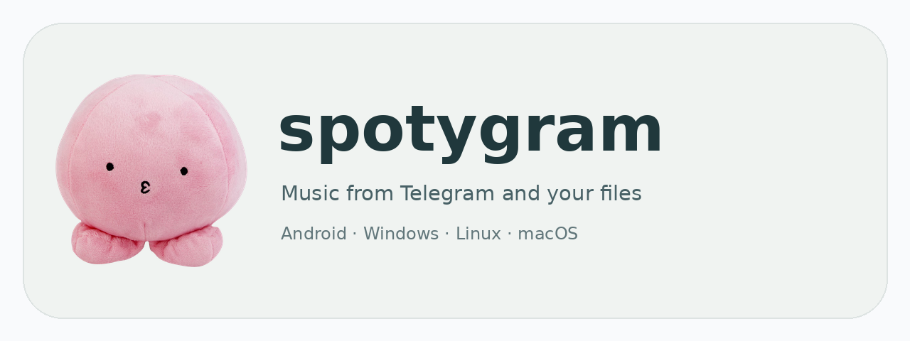
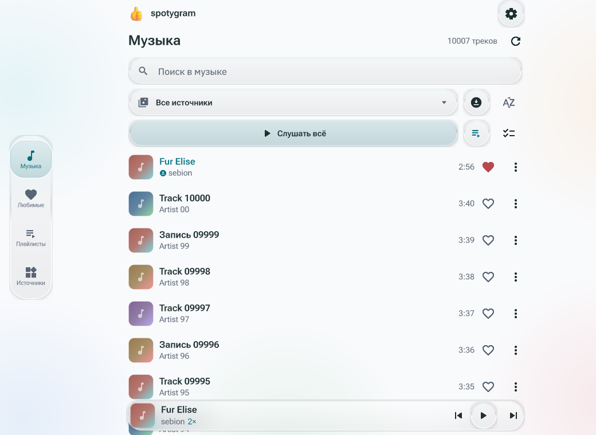
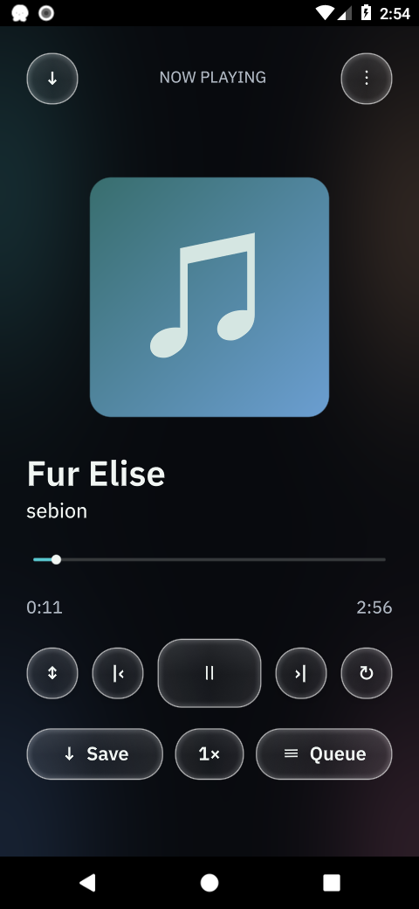

<a href="README.md">English</a> · <strong>Русский</strong>

# spotygram rust

Музыкальный плеер для чатов Telegram, музыки профилей и локальных файлов.
Это личная **Rust-версия**, которая развивается в ветке `rust-rewrite` для
Android, Windows, Linux и macOS. Общий интерфейс работает на Makepad,
desktop-воспроизведение — на libmpv, Android-воспроизведение — на Media3.
Подключение к Telegram идёт напрямую через TDLib.

**Это экспериментальное приложение с отдельными локальными данными.** Стабильная
Kotlin-версия остаётся в [`main`](https://github.com/Krablante/spotygram/tree/main).
Тестовые выпуски используют теги `rust-v…` и помечаются как prerelease. Они не
становятся последним стабильным релизом GitHub. Java runtime в desktop-пакетах нет.

[Скачать тестовую Rust-версию](https://github.com/Krablante/spotygram/releases/tag/rust-v0.1.0)
· [Как пользоваться](docs/usage.ru.md) · [Собрать из исходников](docs/build.ru.md)
· [Проверки и ограничения](docs/verification.ru.md)

 

## Установка и первый запуск

| Устройство | Тестовый пакет | Требования |
| --- | --- | --- |
| Android ARM64 | `spotygram-rust-…-arm64.apk` | Android 8.0+, 64-битный ARM, OpenGL ES 3 |
| Android x86-64 | `spotygram-rust-…-x86_64.apk` | Android 8.0+, x86-64, OpenGL ES 3 |
| Windows | `spotygram-rust-…-windows-x64.zip` | Windows 10+, x86-64, GPU с Direct3D 11 (feature level 11.0) |
| Linux | `spotygram-rust-…-linux-x64.tar.gz` | Ubuntu 24.04+ или совместимое графическое Linux-окружение, x86-64 |
| macOS Apple Silicon | `spotygram-rust-…-macos-arm64.zip` | macOS 14+ |
| macOS Intel | `spotygram-rust-…-macos-x64.zip` | macOS 14+ |

APK устанавливается рядом со стабильным Spotygram. На компьютере распакуй
**архив целиком** и запусти `spotygram-rust.exe`, Linux-лаунчер `spotygram-rust`
или `spotygram rust.app`. Соседние нативные библиотеки и ресурсы нужны для работы.
Для входа в Telegram на Linux требуется разблокированное хранилище Secret Service.

У Windows-пакетов нет сертификата издателя Authenticode. macOS-пакеты подписаны
локально и не проходят нотариализацию Apple. При первом запуске может
понадобиться **Системные настройки → Конфиденциальность и безопасность → Всё
равно открыть**.

Для прослушивания без аккаунта открой **Настройки → Импортировать аудиофайлы**.
На компьютере также можно перетащить файлы в окно или нажать **Ctrl/⌘+O**.
Для музыки Telegram подключи аккаунт в настройках, затем выбери чаты или
профили в **Источниках**. Опубликованные пакеты уже содержат API-конфигурацию
приложения Telegram.

У тестовой версии отдельные сеанс Telegram, база и каталог импортированных
файлов. **Облачные плейлисты, избранное, подключённые источники и настройки
медиатеки общие со стабильным Spotygram при входе в один аккаунт.** Изменение
этих данных в любой версии меняет одну синхронизируемую медиатеку. Очередь,
позиции, громкость и скорость у каждого приложения свои.

## Во время прослушивания

В медиатеке есть поиск, сортировка, фильтр источников, избранное и плейлисты.
Каталог читает страницы из SQLite и рисует видимые строки. Метаданные всех
песен постоянно держать в интерфейсе не требуется. Обложки декодируются под
размер элемента. Сохранены русский и английский языки, светлое и тёмное
оформление, стеклянные элементы и исходное фото Такопи.

Мини-плеер открывает полный плеер и очередь. Есть прямой и обратный порядок,
перемешивание, случайный выбор, три режима повтора и скорость **0,3×–4×**
с сохранением высоты тона. Для длинных записей работают локальные закладки
с настраиваемым порогом длительности. На компьютере доступны громкость,
выключение звука и системные медиакнопки. На Android — фоновый медиасервис
и управление с экрана блокировки.

Меню записи позволяет скачать её, добавить в плейлист или профиль Telegram,
отправить в чат. Отправка требует подтверждения и заново проверяет права
получателя. В выборе получателя есть папки чатов и темы форумов. Для перестановки
очереди и плейлиста используются **Переместить выше / Переместить ниже**.

Импорт копирует файлы в каталог приложения. Сохранённые вручную загрузки
остаются на устройстве. Настройка **Удалять прослушанный кеш** разрешает удалять
старые временные копии воспроизведения Telegram. Удаление импортированной
копии требует подтверждения; исходный внешний файл сохраняется.

Закрытие активного desktop-плеера сворачивает окно. **Ctrl/⌘+Q** или **Закрыть**
в настройках сохраняет состояние и завершает приложение. **Esc** закрывает
открытую панель или плеер. Тестовые обновления проверяются вручную в настройках
и открывают страницу Rust-prerelease. Канал стабильных установщиков и обновлений
для этого не используется.

## Разработка

Начни с [инструкции по сборке](docs/build.ru.md) и [архитектуры](docs/architecture.ru.md).
Генерируемые данные, нативные зависимости и пакеты релизов хранятся вне исходников
в `SPOTYGRAM_STATE`. Интерфейс и логика библиотеки написаны на Rust. Небольшой
Java-слой Android обслуживает activity, выбор файлов, Keystore и сервис Media3.

Измерения и покрытие платформ описаны в [проверках](docs/verification.ru.md).
Меньший runtime сам по себе не доказывает снижение расхода батареи или более
плавную отрисовку на конкретном устройстве. Перед заменой стабильного приложения
тестовую версию нужно проверить на устройствах.

[Сторонние компоненты](docs/third-party.ru.md) · [Лицензия MIT](LICENSE)
