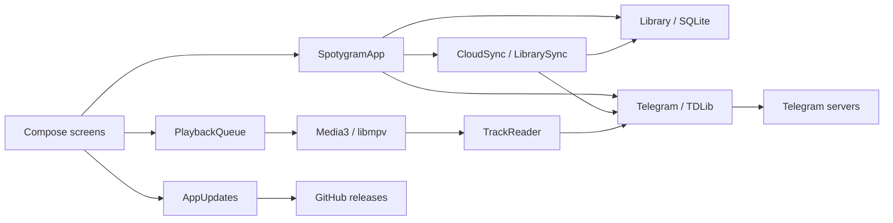

# Architecture

[Documentation](README.md) · **English** · [Русский](architecture.ru.md)

Spotygram runs Telegram access, the music library and playback on the device.
Android, Windows, Linux and macOS compile the same Kotlin/Compose application
source. Platform code supplies OS facilities and a native audio engine.

There is no backend, local HTTP proxy, web view or second media cache.
For installation and profile locations, use the [user guide](usage.md).
For tool versions, credentials, packaging and publishing, use the [build guide](build.md).

## Source and responsibilities

| Part | Owns | Depends on |
| --- | --- | --- |
| `shared/` | Screens, resources, catalog, Telegram requests, queue and cache rules | Small `Platform`, `TdClient` and `Player` contracts |
| `app/` | Android lifecycle, file picker, Keystore, SQLite, services, Media3 and APK installation | Shared application source and Android APIs |
| `desktop/` | Window/tray, activation, OS key stores, SQLite JDBC, libmpv, media controls and archive installation | Shared application source and JVM/native libraries |
| `tools/` | Native Android build, pinned desktop dependencies, application images and signed archives | Build state outside source |

`shared/` is a source directory, not another Gradle module or separately published
library. The two platform modules compile it directly. Shared dependency versions
live in the root build file; engine and OS dependencies live in their module.

`SpotygramApp` coordinates imports, source discovery and user actions. `Telegram`
owns one TDLib client, authorization and request correlation. `Library` owns SQLite
and immutable catalog snapshots. Screens use those snapshots, not TDLib's database.
`SpotygramUI` owns navigation and sheets; individual screen files own their layouts.
`Design.kt` owns the common glass material.

`PlaybackQueue` owns ordering, speed persistence and listening positions. Engines
decode and report native events. `ListeningCache` owns temporary playback files;
`MusicCache` coordinates explicit global cleanup. `Downloads` owns one persisted,
sequential download queue. Android hosts it in a foreground service; desktop keeps
it in the application while the window is hidden.
The download worker reads its pending list once, then advances a cursor. Appending
marks it for refresh; draining triggers the final empty check. It does not copy
the whole pending list before every file. Its active task, including initial
resolution, keeps desktop alive when the window closes.

## Sending audio

`Sharing` owns recipient eligibility, account-scoped pinned/recent recipients and
one explicit send. `SharingSheet` combines quick cards with paged TDLib chat lists,
folders, search and a fixed confirmation area. Directory order changes reuse
cached permission results; permission events invalidate them. Visible picker work
stops with its lifecycle, and avatars use the existing two shared slots.

Audio and document permissions, personal restrictions, publishing rights and
available personal senders are checked before display and again before sending.
Source message properties distinguish copying from ordinary forwarding. Default
sends copy audio without original sender or caption; keeping the sender with an
existing caption requires keeping that caption. Profile files use the existing
resolver; imports keep their local entry and store a reusable upload reference.
Only a confirmed file-reference failure can retry an import with its local file.
Sharing preferences stay local and recipient history is namespaced by account,
without a schema migration or library-sync document.

The send belongs to the application rather than the chooser. Android reuses its
data-transfer foreground service; desktop retains the process while sending.
TDLib's temporary outgoing messages do not enter the music catalog. The final
send update publishes the permanent message reference, and the interface reports
success only after confirmation.

## Catalog and data

SQLite schema 8 stores tracks, chat and profile sources, playlists, playlist membership, pending
downloads, temporary-file ownership and long-recording progress. Both adapters
apply the same incremental migrations. Playback progress has a cascading track
reference. Account-scoped sync values and metadata share this database. Playlist edits, batch favorite changes, message removal and Telegram
catalog cleanup use transactions; a migration never resets the library.

A chat track's identity is `chat_id:message_id`. Profile tracks use the profile user
ID and a SHA-256 encoding of TDLib's stable remote file key. Chat and profile source
keys have separate namespaces even when both refer to the same person. Numeric TDLib file IDs belong
to one native client lifetime. Startup and client closure invalidate those bindings;
messages or profile audio are resolved again when needed. Stable remote file keys identify shared
copies across restarts. A completed local copy must match its known byte size.
Startup reconciliation clears invalid catalog paths without deleting the files.
Failure to open the catalog fails startup and cannot acknowledge a desktop update.

Discovery scans audio and supported audio documents, following every history cursor.
Each source has separate audio/document cursors and newest-message checkpoints.
Short pages are not treated as the end. Interrupted indexing resumes without
skipping the catch-up range. Discovery collects metadata and does not prefetch audio.

`Profiles` owns user lookup, paginated `getUserProfileAudios` requests and profile
loading state. Metadata parsing and stable-key encoding run off the UI thread.
A full, consistent response replaces profile membership in one transaction; failure,
count changes or missing pages keep the prior list. Profile file lookup registers
TDLib's native file-reference refresh source. Portable descriptors include the user
ID and username; a fresh client can resolve that username while checking the ID,
or load its account contact directory when needed.

The track-menu header checks `isProfileAudio` for that recording. `Profiles`
serializes explicit `addProfileAudio`/`removeProfileAudio` requests and changes the
button after Telegram confirms them. A replaceable refresh job updates an already
opened or selected own profile; it does not delay the button or poll an idle account.
Chat recordings retain Telegram's saving restrictions; ordinary Document files
are excluded because profile music requires Audio files. Imported uploads reuse the
native uploader and store the returned stable file key and remote reference in the
existing track columns, preserving the original local file and entry. Membership
belongs to Telegram and creates no library-sync record or schema migration. Android's
existing data-transfer foreground service also keeps explicit profile uploads alive;
desktop window closing retains the process while a profile edit is active.

Browsing stores metadata independently of library membership. Only selected profiles,
favorite songs and playlist members enter Music and the playlist editor; retained
playback copies remain available in On device. Preview metadata keeps twelve recent
profiles plus selected/current profiles and users referenced by the local queue.
Cleanup preserves favorites, playlist members, downloaded files, pending downloads
and long-audio bookmarks. Profile work is cancelled before logout or application
closure. There is no contact-wide music scan or idle profile polling.

TDLib owns the chat directory. The picker loads main/archive lists independently
of typing, displays local search first, and supplements it with debounced server
results. IDs are unique in the merged view; secret chats stay excluded. Native
directory events coalesce over 200 ms. Picker work stops with its visible lifecycle;
errors wait for refresh, reconnection or a new query rather than retrying in a loop.
Only events used by the music catalog enter the application's update queue.

`ChatPhotos` retains photo metadata only for requested chats. Visible rows request
the small JPEG through `getChat` and reuse TDLib's file cache; chat-photo events
invalidate changed or removed pictures. Chat and profile avatar jobs share two
slots and low download priority. Leaving a row stops its work; reconnecting,
returning to the view or explicit refresh retries missing chat images. Client
closure cancels the jobs and clears native identities. Photos stay on each device
and add no catalog schema or library-sync fields.

`Library.reload` reads the entire visible catalog and all playlist membership in
five queries, regardless of the number of playlists. ID lookup and enabled duplicate
grouping are prepared on IO before publishing a changed snapshot. Local-file groups
are cached on demand. Shared-thumbnail aliases update in one transaction and one
reload. Missing paths are checked once per distinct path/size pair.

The catalog still lives in memory: its storage cost is **O(tracks + memberships)**.
Search/filtering scans metadata, sorting costs **O(n log n)**, and a reload reads the
whole catalog. Lazy lists limit drawing, not catalog memory. This design fits the
observed collection; it is not a claim of tested performance at hundreds of thousands
of distinct recordings. See the [verification record](verification.md).

Duplicate hiding is a reversible view over Music, Favorites and On device. A
snapshot joins stable file keys, shared paths and exact normalized
title/artist/duration/size signatures without file hashing or pairwise comparisons.
Known duration and size are required for metadata matching. Filters run before
choosing a retained local, temporary local or available remote representative.
Group favorites and highlights include hidden aliases; Undo restores exact previous
marks. Explicit playlists and queues keep their entries. Hidden physical copies
still contribute to storage size.

Imports create an app-owned copy. Copying checks cancellation between chunks;
failed imports remove their staged audio and artwork. Once SQLite owns the entry,
a later reload or notification failure keeps its files. Deletion removes a catalog
entry only after the corresponding local files have actually been removed.

## Automatic library sync

`LibrarySync` owns portable user data and its durable pending flags. User edits
write the local catalog and the corresponding sync values in one SQLite transaction.
Playlists have stable UUIDs independent of their local numeric row IDs. Track
descriptors carry metadata and Telegram message or profile references, never local paths or
native file IDs. This lets favorites and playlist membership exist before indexing.
Imported audio remains local; peers receive an unavailable metadata entry.

Each field has a logical clock and a device UUID. Receiving a version advances the
local clock; ties use the writer UUID, so replay and duplicate sends converge.
Playlist membership is versioned per song; ordering retains concurrent additions.
Deletion tombstones survive snapshots and prevent old offline playlist edits from
restoring a removed identity. The first migration seeds existing playlists,
favorites, sources, referenced tracks and preferences. Schema 7 retires cloud queue
and progress records while preserving local queue preferences and bookmarks. JSON
object fields are encoded in sorted order for equal values on Android and desktop.
Signing out detaches that account's records without publishing catalog cleanup.

`CloudSync` owns channel discovery and one coalesced IO worker. It loads both chat
lists and checks owned channels for an account-bound description marker, including
renamed storage. Simultaneous first-run channels converge on the same canonical
channel while reading the others. The channel gets a random `spotygram-` title,
permanent mute, archive placement and no message auto-deletion. Sends are silent;
`openChat` supplies live events. Startup and reconnection reconcile history.
There is no idle polling; server delays and bounded retry backoff preserve pending
edits. Missing remembered storage reports an error instead of silently replacing it.

Gzip JSON documents carry format, account, record versions and a SHA-256 digest in
the caption. Small batches carry changes. Format 3 adds selected profiles and profile
audio references, and reads formats 1 and 2 while ignoring legacy cloud playback.
Clients through 0.18.0 pause on format 3 until upgraded. Full snapshots omit track
descriptors used only by playback or profile previews.
An initial or large pending batch produces a full snapshot. A one-shot deferred pass
consolidates a dirty channel after 60 seconds; 16 retained tail documents trigger
earlier consolidation, counting shared history across writers. This does not poll
an idle channel. The snapshot's `through` boundary permits deleting only protocol
messages already incorporated from that channel. Cleanup debt is durable and cleared
only after successful deletion; reconnection resumes it. Versions and tombstones
remain in the snapshot. Confirmation waits for TDLib's final send
result before clearing the exact sent versions; newer edits remain pending.
Reads validate the complete incoming collection before one merge transaction.
Unknown formats and invalid documents retain the catalog and pending edits.
Documents are bounded to 8 MiB compressed and 32 MiB expanded; downloaded sync
documents and upload staging files are discarded after use.

Library settings apply through the same shared app controls. Speed, order, repeat,
volume and mute stay local, together with the queue, last track and listening
positions. Startup removes old speed/order/repeat records from local sync storage;
incoming legacy settings are ignored without rejecting other library records.
The profile extension uses format 3; existing library records remain readable.
Five-second checkpoints, pause, seek, track change and orderly exit write only local
playback storage. Audio copies, downloads, indexing
checkpoints, native sessions and installation state belong to each device.
The channel uses Telegram cloud protection; there is no separate encryption key.

## Playback and persistence

The complete queue stays inside `PlaybackQueue`. Each engine receives at most
previous/current/next. Android posts window changes after Media3 transition callbacks
so controllers see a consistent timeline. Queue entries use source indices, allowing
intentional repeats. Shuffle uses Fisher–Yates and retains at most two passes.
Repeat-all avoids a shuffled boundary repeat. Absolute random draws independently
and keeps 32 previous choices, the current choice and one prepared next choice.

Reverse order traverses source indices downward while preserving the selected song
and position on mode changes. Queue insertion and upward moves follow the displayed
playback order; library and playlist lists keep their own ordering. Mode preferences
are local and independent of the saved queue, including an empty queue.

One conflated IO writer saves immutable queue snapshots. Structural changes write
the full list; position, mode and cursor use separate version-linked preferences.
Five-second playback checkpoints and pause/seek/selection/lifecycle events save
dirty long-recording positions in one transaction. Completion retires bookmarks,
including repeat-one. Changed file identity/size and out-of-range positions cannot
resume. Restoration is paused and waits for catalog reconciliation and progress load.

Speed is 0.3×–4× with pitch correction. A 300 ms deferred preference write coalesces
slider movement; closing the queue flushes it. Speed changes do not rebuild the queue.

Desktop libmpv applies software volume in the 0–100% range. The full player and
mini-player popup observe the same engine events. Mute retains the last nonzero
level. One 300 ms deferred preference write coalesces volume changes; engine release
flushes it. These preferences live only in the desktop profile.

`TrackReader` reads available on-disk TDLib ranges through both engines. Missing
ranges wait for native file events, with a 60-second read timeout. Replacement or
closing cancels the wait. A reader error stops playback without becoming successful
end-of-file or clearing the bookmark. A NIO file channel permits TDLib to rename a
completed download while the reader remains open on Windows; positional reads keep
using that handle. Media3 targets a 15–30 second buffer; libmpv
reads ahead up to 30 seconds within an 8 MiB demuxer limit. These are settings,
not measured latency promises.

Android `PlayerConnection` exists from Activity STARTED to STOPPED. Each attempt has
a ten-second deadline and one automatic retry. The latest pending selection runs
once after readiness; leaving cancels that pending start while active music continues.
Callback generations reject obsolete controllers. UI callbacks capturing changing
state use lambdas rather than function references that can retain stale captures.

Desktop uses one profile lock, event-driven file activation and Nucleus media controls:
MPRIS, SMTC and MPNowPlayingInfoCenter. Nucleus dispatches commands to Swing's UI
thread. Play is idempotent, including buffering; Toggle remains a state change.
Hiding/minimizing stops UI observations and picker work. Quit flushes playback and
preferences and closes native resources before releasing the profile lock.

Desktop Play/Pause commands own playback intent. The native pause used while
loading another file cannot replace that intent. File events belong to the native
playlist entry and load generation; replacing a stream cancels its pending reads.
Duration and buffering updates use the captured native event values.
libmpv's playback-restart event acknowledges a seek. Its audio clock can differ
from the requested position because of output latency and speed; it is not used
as a completion tolerance. A new seek rejects restart work already queued for an
older request on the UI thread.

## File ownership and account security

By default, completed Telegram files remain offline; TDLib's storage optimizer is
disabled. Optional temporary playback uses `temporary_audio`, keyed by stable remote
identity. Pre-existing copies, imports and explicit downloads remain retained.
The queue's working window and reader leases protect files; per-file mutexes serialize
opening with deletion. Explicit Download pins known aliases and removes temporary
ownership. Turning the mode off retains remaining journal-owned files.

Cleanup follows events rather than a timer or directory scanner. Each pass attempts
at most four eligible files. It resolves current native identity, rechecks protection,
journals the actual path, cancels transfer, deletes through TDLib and verifies both
native state and file absence before retiring ownership. Failures keep the journal
and impose a one-minute floor on event-driven retries. This is a working-set policy,
not a strict byte quota or RAM-only streaming.

Global cache cleanup waits for automatic cleanup, stops playback/downloads and waits
for readers. TDLib removes audio/document copies, including explicitly saved music;
imports remain. One reconciliation transaction updates missing paths, then restores
the logical queue paused. Favorites, playlists and sign-in remain. Late completion
events validate the file before making it offline again.

The random TDLib database key is wrapped with Android Keystore AES-GCM or stored in
Windows Credential Manager, macOS Keychain or Linux Secret Service. An existing
database never receives a replacement key when the original is missing. Initialization
reads that key before creating the Telegram database and file directories, then passes
absolute native paths to TDLib. Directory creation runs on IO. Android
backups are disabled. The catalog and audio use private per-user storage without
separate per-file encryption. Telegram sign-in grants a full account session; source
selection limits indexing, not account permissions. Logout clears this device's Telegram catalog
records and playlist references while keeping imports and account-scoped sync data.
Network payloads are not logged.

During unfinished phone sign-in, Back opens phone entry while retaining TDLib's
actual code, password or email state. Submitting another number uses
`setAuthenticationPhoneNumber`; it does not log out or reset the catalog. Failed
submissions keep phone entry and show the error. Pending QR login uses the existing
unfinished-client restart because TDLib cannot directly replace that state with a
phone number. Android Back, desktop Esc and the screen arrow share this behavior.

`Telegram` serializes authentication requests and retains the server's code
destination, delivery type, next type and monotonic resend deadline. The screen
binds submitted text to its visible authorization step and destination, so a
delayed frame cannot submit a phone number as a code after TDLib advances. It
counts down only while visible; it never resends automatically. A resend requires
both the next type and an expired deadline. Missed-call delivery is allowed because
the caller digits can be entered manually; flash-call, SMS retriever and Firebase
facilities are not advertised.

## Visual system and idle work

English/Russian strings are shared XML resources. The library header pairs the
lowercase `spotygram` name with one of 40 bundled Fluent Emoji stickers: 18 yellow
hand gestures and 22 faces. Every transparent PNG shares a 112-pixel canvas and
balanced insets inside the existing 28 dp slot. The sticker is decorative, with
no glass effect, animation or separate accessibility announcement.

`HeaderSticker` belongs to `SpotygramApp`, so navigation, theme/language changes
and Android activity recreation keep the same choice. A new application process
selects a new sticker; returning after at least 30 minutes hidden or minimized
selects another. Consecutive selections never repeat. Android activity and desktop
window visibility events drive the same logic. A timestamp of hiding includes
device sleep, with no background timer. Only the previous sticker's stable name
is saved in separate local preferences; it creates no library, playback or
cloud-sync records.

The honey-glass mark with rounded ears and a curled antenna remains on welcome
and sign-in screens. Android and desktop load that same transparent PNG. System
icons place the mark on a pale liquid-glass surface. Desktop packaging derives
PNG, multi-size ICO and ICNS from the shared `spotygram_launcher.png`; the window
and tray use that tile too. Android keeps the standalone mark in the adaptive
foreground with proportional safe-area insets, and extends the matching glass
background beyond the launcher mask.
Its white silhouette remains available for themed icons and notifications.
Reflections are baked into the images; these assets need no live blur or animation.

`Design.kt` feeds explicit background/content captures to Haze Glass 2.0.1. Controls are outside their own capture;
dense glass diffuses text underneath. Primary edge refraction, dispersion and lighting
remain, while the secondary detail pass is disabled. There is no row effect or animated
wallpaper. Desktop and Android 13+ use full optics; older Android uses denser tint,
lighting and rim fallback. Compose/Haze follows the system reduced-motion policy.
Static environment and rim gradients are cached until their size or theme changes.
Windows uses Skiko's default Direct3D path, which performs drawing and presentation
outside the UI event thread. A startup check selects ANGLE when no hardware
DXGI adapter supports Direct3D 12; ANGLE was faster than software Direct3D in native
measurements. The choice is made before creating a window. Explicit Skiko renderer
overrides remain available; both paths use the same glass material.

At 840 dp, navigation becomes a side rail; wide players separate artwork and controls.
Music lists are bounded to 720 dp. Narrow/increased-font toolbars use icons with 48 dp
secondary touch targets. Sheet glass travels inside its native placement transform;
keyboard layout changes preserve text-field identity and focus.

Track actions share one header and list. The profile button is centered beneath
the artwork/title row with short To profile/Remove labels and a 48 dp minimum touch
target. Its width fits the longer label at the current font size and stays equal
in both states; screen readers retain the full action descriptions. Widths from 600 dp use a
menu anchored to the chosen track's three-dot button; narrower windows use the
native bottom sheet. Both surfaces bound their height and scroll longer content.

Sources uses lazy rows inside common glass panels. Each visible group draws one
surface bounded to the viewport, including groups taller than the screen. The
source chooser keeps search and management controls outside its scrolling list,
reveals the current choice and uses denser rows in wide-window popups. Its inner
glass surfaces select the environment capture only, so library text cannot show
through source names or the search field. Narrow widths use the existing native
bottom sheet; widths from 600 dp use an anchored popup.

SQLite, copying, metadata and page parsing stay off the UI thread. Indexing publishes
at most twice per second plus completion. UI progress timers belong to visible player
components. Android reports network events; desktop TDLib handles reconnection.
Desktop Wi-Fi detection runs only during explicit downloads. There is no idle network
polling. The bundled Java runtime uses a 256 MiB heap limit; native audio, Telegram and
graphics memory remain outside that limit.

## Update trust and installation

`AppUpdates` makes one foreground-triggered request to the fixed public GitHub latest
release endpoint. Attempts persist before network access: 24 hours automatically,
one minute manually, with saved rate-limit cooldown. ETag/304 reuses valid metadata;
5/8 second connect/read timeouts, a 256 KiB response limit and no redirects bound
release checking. Only ordinary numeric releases with the exact uploaded host asset
are accepted. Downloads require an explicit action.

Android DownloadManager owns transfer; only the resumed Activity polls active progress.
Private APK verification checks exact size, GitHub SHA-256, package/version, increasing
versionCode and current signer set. A non-exported FileProvider grants read access only
to that verified APK. Unknown-source permission and installation use Android's own UI;
cancellation or denial does not reopen prompts automatically.

Desktop installers wrap the existing jpackage image: per-user Inno Setup EXE with shortcuts
and a stable upgrade identity, Ubuntu DEB with a menu entry, and DMG with an
Applications shortcut. An image resource marker selects native package updates;
there is no second application or profile. These updates verify GitHub SHA-256 and
the existing Ed25519 key's detached signature over the exact package name and digest,
then open the OS installer after confirmation. The OS owns installation/removal;
removal leaves the separate user profile. Windows binaries default to
`%LOCALAPPDATA%\SpotygramApp`, apart from `%LOCALAPPDATA%\Spotygram` data.

The Windows EXE enumerates the old MSI upgrade family for the current user and
removes matching Spotygram products before installation, retaining their program
directory. A logged `Config.Msi` error 1926 or 1314 permits one retry of that
removal with `DISABLEROLLBACK=1`; no system policy or drive permissions are changed.
Failure stops setup and gives the log path. Subsequent installation and removal
use Inno Setup and do not depend on Windows Installer rollback. Old MSI clients
require one manual EXE download because their updater expects an MSI asset.
Setup also removes obsolete JARs named by an existing Spotygram launcher config
after the new files are installed. This covers files left by a failed MSI removal;
files absent from that old classpath remain untouched.

Portable desktop resumes transfer and verifies SHA-256, detached Ed25519 signature, target,
version and every extracted file. Extraction bounds paths, links, entry count and
expanded bytes, including copied hard links. After restart confirmation, a cache-owned
helper waits for the old process and prepares a verified replacement on the installation
filesystem. It restores the previous application if the new launcher cannot start or
the new catalog cannot acknowledge startup. Profiles and credential keys stay outside
the replaced tree. On Windows, stopping a failed launch or aborting a helper stops
its launcher and JVM descendants before releasing their files.
macOS bundles are ad hoc signed; publisher trust for updates comes
from the manifest signature. Apple notarization is not configured.

The exact asset names and signing-key requirements are in the [build guide](build.md).
Observed behavior and remaining limits are in the [verification record](verification.md).
