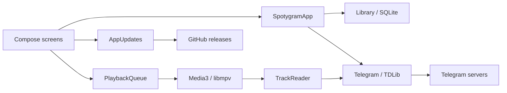

# Architecture

[Documentation](README.md) · **English** · [Русский](architecture.ru.md)

Spotygram runs Telegram access, the music library and playback on the device.
Android, Windows, Linux and macOS compile the same Kotlin/Compose application
source. Platform code supplies OS facilities and a native audio engine.

There is no backend, local HTTP proxy, web view or second media cache.
For installation and profile locations, use the [user guide](usage.md).
For tool versions, credentials, packaging and publishing, use the [build guide](build.md).

## Source and responsibilities

| Part | Owns | Depends on |
| --- | --- | --- |
| `shared/` | Screens, resources, catalog, Telegram requests, queue and cache rules | Small `Platform`, `TdClient` and `Player` contracts |
| `app/` | Android lifecycle, file picker, Keystore, SQLite, services, Media3 and APK installation | Shared application source and Android APIs |
| `desktop/` | Window/tray, activation, OS key stores, SQLite JDBC, libmpv, media controls and archive installation | Shared application source and JVM/native libraries |
| `tools/` | Native Android build, pinned desktop dependencies, application images and signed archives | Build state outside source |

`shared/` is a source directory, not another Gradle module or separately published
library. The two platform modules compile it directly. Shared dependency versions
live in the root build file; engine and OS dependencies live in their module.

`SpotygramApp` coordinates imports, source discovery and user actions. `Telegram`
owns one TDLib client, authorization and request correlation. `Library` owns SQLite
and immutable catalog snapshots. Screens use those snapshots, not TDLib's database.
`SpotygramUI` owns navigation and sheets; individual screen files own their layouts.
`Design.kt` owns the common glass material.

`PlaybackQueue` owns ordering, speed persistence and listening positions. Engines
decode and report native events. `ListeningCache` owns temporary playback files;
`MusicCache` coordinates explicit global cleanup. `Downloads` owns one persisted,
sequential download queue. Android hosts it in a foreground service; desktop keeps
it in the application while the window is hidden.
The download worker reads its pending list once, then advances a cursor. Appending
marks it for refresh; draining triggers the final empty check. It does not copy
the whole pending list before every file. Its active task, including initial
resolution, keeps desktop alive when the window closes.

## Catalog and data

SQLite schema 5 stores tracks, sources, playlists, playlist membership, pending
downloads, temporary-file ownership and long-recording progress. Both adapters
apply the same incremental migrations. Playback progress has a cascading track
reference. Playlist edits, batch favorite changes, message removal and Telegram
catalog cleanup use transactions; a migration never resets the library.

A Telegram track's identity is `chat_id:message_id`. Numeric TDLib file IDs belong
to one native client lifetime. Startup and client closure invalidate those bindings;
messages are resolved again when needed. Stable remote file keys identify shared
copies across restarts. A completed local copy must match its known byte size.
Startup reconciliation clears invalid catalog paths without deleting the files.
Failure to open the catalog fails startup and cannot acknowledge a desktop update.

Discovery scans audio and supported audio documents, following every history cursor.
Each source has separate audio/document cursors and newest-message checkpoints.
Short pages are not treated as the end. Interrupted indexing resumes without
skipping the catch-up range. Discovery collects metadata and does not prefetch audio.

TDLib owns the chat directory. The picker loads main/archive lists independently
of typing, displays local search first, and supplements it with debounced server
results. IDs are unique in the merged view; secret chats stay excluded. Native
directory events coalesce over 200 ms. Picker work stops with its visible lifecycle;
errors wait for refresh, reconnection or a new query rather than retrying in a loop.
Only events used by the music catalog enter the application's update queue.

`Library.reload` reads the entire visible catalog and all playlist membership in
four queries, regardless of the number of playlists. ID lookup and enabled duplicate
grouping are prepared on IO before publishing a changed snapshot. Local-file groups
are cached on demand. Shared-thumbnail aliases update in one transaction and one
reload. Missing paths are checked once per distinct path/size pair.

The catalog still lives in memory: its storage cost is **O(tracks + memberships)**.
Search/filtering scans metadata, sorting costs **O(n log n)**, and a reload reads the
whole catalog. Lazy lists limit drawing, not catalog memory. This design fits the
observed collection; it is not a claim of tested performance at hundreds of thousands
of distinct recordings. See the [verification record](verification.md).

Duplicate hiding is a reversible view over Music, Favorites and On device. A
snapshot joins stable file keys, shared paths and exact normalized
title/artist/duration/size signatures without file hashing or pairwise comparisons.
Known duration and size are required for metadata matching. Filters run before
choosing a retained local, temporary local or available remote representative.
Group favorites and highlights include hidden aliases; Undo restores exact previous
marks. Explicit playlists and queues keep their entries. Hidden physical copies
still contribute to storage size.

Imports create an app-owned copy. Copying checks cancellation between chunks;
failed imports remove their staged audio and artwork. Once SQLite owns the entry,
a later reload or notification failure keeps its files. Deletion removes a catalog
entry only after the corresponding local files have actually been removed.

## Playback and persistence

The complete queue stays inside `PlaybackQueue`. Each engine receives at most
previous/current/next. Android posts window changes after Media3 transition callbacks
so controllers see a consistent timeline. Queue entries use source indices, allowing
intentional repeats. Shuffle uses Fisher–Yates and retains at most two passes.
Repeat-all avoids a shuffled boundary repeat. Absolute random draws independently
and keeps 32 previous choices, the current choice and one prepared next choice.

One conflated IO writer saves immutable queue snapshots. Structural changes write
the full list; position, mode and cursor use separate version-linked preferences.
Five-second playback checkpoints and pause/seek/selection/lifecycle events save
dirty long-recording positions in one transaction. Completion retires bookmarks,
including repeat-one. Changed file identity/size and out-of-range positions cannot
resume. Restoration is paused and waits for catalog reconciliation and progress load.

Speed is 0.3×–4× with pitch correction. A 300 ms deferred preference write coalesces
slider movement; closing the queue flushes it. Speed changes do not rebuild the queue.

`TrackReader` reads available on-disk TDLib ranges through both engines. Missing
ranges wait for native file events, with a 60-second read timeout. Replacement or
closing cancels the wait. A reader error stops playback without becoming successful
end-of-file or clearing the bookmark. Media3 targets a 15–30 second buffer; libmpv
reads ahead up to 30 seconds within an 8 MiB demuxer limit. These are settings,
not measured latency promises.

Android `PlayerConnection` exists from Activity STARTED to STOPPED. Each attempt has
a ten-second deadline and one automatic retry. The latest pending selection runs
once after readiness; leaving cancels that pending start while active music continues.
Callback generations reject obsolete controllers. UI callbacks capturing changing
state use lambdas rather than function references that can retain stale captures.

Desktop uses one profile lock, event-driven file activation and Nucleus media controls:
MPRIS, SMTC and MPNowPlayingInfoCenter. Nucleus dispatches commands to Swing's UI
thread. Play is idempotent, including buffering; Toggle remains a state change.
Hiding/minimizing stops UI observations and picker work. Quit flushes playback and
preferences and closes native resources before releasing the profile lock.

## File ownership and account security

By default, completed Telegram files remain offline; TDLib's storage optimizer is
disabled. Optional temporary playback uses `temporary_audio`, keyed by stable remote
identity. Pre-existing copies, imports and explicit downloads remain retained.
The queue's working window and reader leases protect files; per-file mutexes serialize
opening with deletion. Explicit Download pins known aliases and removes temporary
ownership. Turning the mode off retains remaining journal-owned files.

Cleanup follows events rather than a timer or directory scanner. Each pass attempts
at most four eligible files. It resolves current native identity, rechecks protection,
journals the actual path, cancels transfer, deletes through TDLib and verifies both
native state and file absence before retiring ownership. Failures keep the journal
and impose a one-minute floor on event-driven retries. This is a working-set policy,
not a strict byte quota or RAM-only streaming.

Global cache cleanup waits for automatic cleanup, stops playback/downloads and waits
for readers. TDLib removes audio/document copies, including explicitly saved music;
imports remain. One reconciliation transaction updates missing paths, then restores
the logical queue paused. Favorites, playlists and sign-in remain. Late completion
events validate the file before making it offline again.

The random TDLib database key is wrapped with Android Keystore AES-GCM or stored in
Windows Credential Manager, macOS Keychain or Linux Secret Service. An existing
database never receives a replacement key when the original is missing. Initialization
reads that key before creating the Telegram database and file directories, then passes
absolute native paths to TDLib. Directory creation runs on IO. Android
backups are disabled. The catalog and audio use private per-user storage without
separate per-file encryption. Telegram sign-in grants a full account session; source
selection limits indexing, not account permissions. Logout clears Telegram catalog
records and playlist references while keeping imports. Network payloads are not logged.

During unfinished phone sign-in, Back opens phone entry while retaining TDLib's
actual code, password or email state. Submitting another number uses
`setAuthenticationPhoneNumber`; it does not log out or reset the catalog. Failed
submissions keep phone entry and show the error. Pending QR login uses the existing
unfinished-client restart because TDLib cannot directly replace that state with a
phone number. Android Back, desktop Esc and the screen arrow share this behavior.

## Visual system and idle work

English/Russian strings and the RGB brand vector are shared XML resources. Android
uses native resources; desktop reads those same XML files. `Design.kt` feeds explicit
background/content captures to Haze Glass 2.0.1. Controls are outside their own capture;
dense glass diffuses text underneath. Primary edge refraction, dispersion and lighting
remain, while the secondary detail pass is disabled. There is no row effect or animated
wallpaper. Desktop and Android 13+ use full optics; older Android uses denser tint,
lighting and rim fallback. Compose/Haze follows the system reduced-motion policy.

At 840 dp, navigation becomes a side rail; wide players separate artwork and controls.
Music lists are bounded to 720 dp. Narrow/increased-font toolbars use icons with 48 dp
secondary touch targets. Sheet glass travels inside its native placement transform;
keyboard layout changes preserve text-field identity and focus.

SQLite, copying, metadata and page parsing stay off the UI thread. Indexing publishes
at most twice per second plus completion. UI progress timers belong to visible player
components. Android reports network events; desktop TDLib handles reconnection.
Desktop Wi-Fi detection runs only during explicit downloads. There is no idle network
polling. The bundled Java runtime uses a 256 MiB heap limit; native audio, Telegram and
graphics memory remain outside that limit.

## Update trust and installation

`AppUpdates` makes one foreground-triggered request to the fixed public GitHub latest
release endpoint. Attempts persist before network access: 24 hours automatically,
one minute manually, with saved rate-limit cooldown. ETag/304 reuses valid metadata;
5/8 second connect/read timeouts, a 256 KiB response limit and no redirects bound
release checking. Only ordinary numeric releases with the exact uploaded host asset
are accepted. Downloads require an explicit action.

Android DownloadManager owns transfer; only the resumed Activity polls active progress.
Private APK verification checks exact size, GitHub SHA-256, package/version, increasing
versionCode and current signer set. A non-exported FileProvider grants read access only
to that verified APK. Unknown-source permission and installation use Android's own UI;
cancellation or denial does not reopen prompts automatically.

Desktop installers wrap the existing jpackage image: per-user Inno Setup EXE with shortcuts
and a stable upgrade identity, Ubuntu DEB with a menu entry, and DMG with an
Applications shortcut. An image resource marker selects native package updates;
there is no second application or profile. These updates verify GitHub SHA-256 and
the existing Ed25519 key's detached signature over the exact package name and digest,
then open the OS installer after confirmation. The OS owns installation/removal;
removal leaves the separate user profile. Windows binaries default to
`%LOCALAPPDATA%\SpotygramApp`, apart from `%LOCALAPPDATA%\Spotygram` data.

The Windows EXE enumerates the old MSI upgrade family for the current user and
removes matching Spotygram products before installation, retaining their program
directory. A logged `Config.Msi` error 1926 or 1314 permits one retry of that
removal with `DISABLEROLLBACK=1`; no system policy or drive permissions are changed.
Failure stops setup and gives the log path. Subsequent installation and removal
use Inno Setup and do not depend on Windows Installer rollback. Old MSI clients
require one manual EXE download because their updater expects an MSI asset.
Setup also removes obsolete JARs named by an existing Spotygram launcher config
after the new files are installed. This covers files left by a failed MSI removal;
files absent from that old classpath remain untouched.

Portable desktop resumes transfer and verifies SHA-256, detached Ed25519 signature, target,
version and every extracted file. Extraction bounds paths, links, entry count and
expanded bytes, including copied hard links. After restart confirmation, a cache-owned
helper waits for the old process and prepares a verified replacement on the installation
filesystem. It restores the previous application if the new launcher cannot start or
the new catalog cannot acknowledge startup. Profiles and credential keys stay outside
the replaced tree. On Windows, stopping a failed launch or aborting a helper stops
its launcher and JVM descendants before releasing their files.
macOS bundles are ad hoc signed; publisher trust for updates comes
from the manifest signature. Apple notarization is not configured.

The exact asset names and signing-key requirements are in the [build guide](build.md).
Observed behavior and remaining limits are in the [verification record](verification.md).
