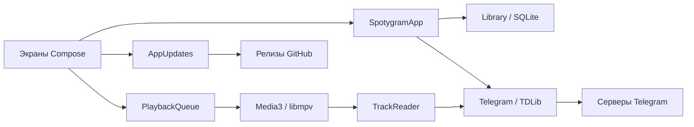

# Устройство приложения

[Документация](README.ru.md) · [English](architecture.md) · **Русский**

Spotygram работает с Telegram, музыкальной библиотекой и звуком на устройстве.
Android, Windows, Linux и macOS компилируют один код Kotlin/Compose. Платформенные
части предоставляют функции ОС и нативный звуковой движок.

Собственного сервера, локального HTTP-прокси, веб-вью и второго медиакэша нет.
Установка и расположение профиля описаны в [руководстве пользователя](usage.ru.md).
Инструменты, ключи, упаковка и публикация — в [руководстве по сборке](build.ru.md).

## Исходники и обязанности

| Часть | Отвечает за | Использует |
| --- | --- | --- |
| `shared/` | Экраны, ресурсы, каталог, запросы Telegram, очередь и правила кэша | Небольшие контракты `Platform`, `TdClient` и `Player` |
| `app/` | Жизненный цикл Android, выбор файлов, Keystore, SQLite, службы, Media3 и установку APK | Общий код приложения и API Android |
| `desktop/` | Окно/трей, активацию, системные ключи, SQLite JDBC, libmpv, медиакнопки и установку архивов | Общий код приложения и JVM/нативные библиотеки |
| `tools/` | Нативную сборку Android, закреплённые desktop-зависимости, образы и подписанные архивы | Рабочие данные сборки вне исходников |

`shared/` — каталог исходников, без отдельного Gradle-модуля или публикуемой
библиотеки. Два платформенных модуля компилируют его напрямую. Общие версии
зависимостей заданы в корневом файле сборки; зависимости движка и ОС — в своём модуле.

`SpotygramApp` координирует импорт, обнаружение источников и действия пользователя.
`Telegram` владеет одним клиентом TDLib, авторизацией и сопоставлением запросов
с ответами. `Library` владеет SQLite и неизменяемыми снимками каталога. Экраны
читают снимки, а не базу TDLib. `SpotygramUI` управляет навигацией и панелями;
отдельные файлы экранов — их разметкой. `Design.kt` задаёт общий материал стекла.

`PlaybackQueue` управляет порядком, сохранением скорости и позиций. Движки
декодируют звук и сообщают нативные события. `ListeningCache` владеет временными
копиями для прослушивания; `MusicCache` координирует явную общую очистку.
`Downloads` ведёт одну сохраняемую последовательную очередь скачивания. На Android
она работает в foreground-службе, на desktop — в приложении при скрытом окне.
Загрузчик один раз читает ожидающий список и двигает курсор. Добавление отмечает
список для перечитывания; завершение проверяет, что он пуст. Весь список не
копируется перед каждым файлом. Активная задача, включая первоначальный запрос,
сохраняет desktop-процесс при закрытии окна.

## Каталог и данные

Схема SQLite 5 хранит треки, источники, плейлисты, их состав, ожидающие загрузки,
владение временными файлами и позиции длинных записей. Оба адаптера применяют
одни последовательные миграции. Позиции каскадно удаляются вместе с записью трека.
Правки плейлистов, пакетные отметки любимых, удаление сообщений и очистка записей
Telegram используют транзакции. Миграции не сбрасывают библиотеку.

Идентификатор трека Telegram — `chat_id:message_id`. Числовой ID файла TDLib
принадлежит одному времени жизни нативного клиента. Запуск и закрытие клиента
сбрасывают привязки; при необходимости сообщения разрешаются заново. Стабильные
удалённые ключи определяют общие копии между запусками. Размер готового файла
должен совпадать с известным размером аудио. Проверка при запуске очищает неверные
пути каталога, не удаляя сами файлы. Ошибка открытия каталога останавливает запуск
и не может подтвердить успешную установку desktop-обновления.

Обнаружение музыки проходит аудио и подходящие аудиодокументы до конца курсоров.
У каждого источника отдельные курсоры аудио/документов и отметки новых сообщений.
Короткая страница не считается концом. Прерванная индексация продолжается без
пропуска новых записей. Она собирает метаданные, не скачивая аудио заранее.

Каталогом чатов владеет TDLib. Окно добавления загружает основной список и архив
независимо от ввода, сначала показывает локальный поиск и затем дополняет его
серверным поиском с задержкой после ввода. Один ID показывается один раз;
секретные чаты исключены. События каталога объединяются за 200 мс. Задачи окна
останавливаются вместе с видимым жизненным циклом. После ошибки новая попытка
ждёт обновления, восстановления связи или нового запроса. В очередь событий
приложения попадают только обновления, используемые музыкальным каталогом.

`Library.reload` читает весь видимый каталог и состав всех плейлистов четырьмя
запросами, независимо от их количества. Поиск по ID и включённая группировка дублей
готовятся на IO до публикации изменённого снимка. Группы локальных файлов кэшируются
по требованию. Все ссылки на общую обложку обновляются одной транзакцией и одним
чтением каталога. Пути проверяются один раз для каждой пары путь/размер.

Каталог остаётся в памяти: его стоимость хранения — **O(треки + связи плейлистов)**.
Поиск и фильтры проходят метаданные, сортировка стоит **O(n log n)**, перечитывание
читает весь каталог. Ленивые списки ограничивают отрисовку, а не память каталога.
Это решение соответствует проверенной коллекции; скорость на сотнях тысяч разных
записей не проверена. Границы приведены в [журнале проверок](verification.ru.md).

Скрытие дублей — обратимое представление «Музыки», «Любимых» и «На устройстве».
Снимок объединяет стабильные ключи, общие пути и точные нормализованные
название/исполнителя/длительность/размер, без хеширования файлов и попарных сравнений.
Для сопоставления метаданных нужны известные длительность и размер. Фильтры идут
до выбора сохранённой локальной, временной локальной или доступной удалённой копии.
Любимые и подсветка учитывают скрытые ссылки; Undo возвращает точные прежние отметки.
Явные плейлисты и очереди сохраняют состав. Скрытые копии входят в объём хранения.

Импорт создаёт собственную копию. Копирование проверяет отмену между блоками;
неудачный импорт удаляет подготовленные аудио и обложку. После записи в SQLite
ошибка перечитывания или уведомления сохраняет файлы. Удаление убирает запись
каталога только после фактического удаления её локальных файлов.

## Воспроизведение и сохранение

Полная очередь находится в `PlaybackQueue`. Движок получает максимум предыдущую,
текущую и следующую записи. Android откладывает сдвиг окна до завершения перехода
Media3, чтобы контроллеры видели согласованную очередь. Записи используют индексы
подборки, позволяя намеренные повторы. Перемешивание использует Фишера — Йетса
и хранит максимум два прохода. Повтор всей подборки не повторяет песню на границе
перемешанных проходов. Абсолютный рандом выбирает независимо и хранит 32 предыдущих
выбора, текущий и один подготовленный следующий.

Один IO-писатель объединяет ожидающие неизменяемые снимки. Структурные изменения
пишут весь список; позиция, режим и курсор — отдельные настройки, связанные версией.
Контрольная запись раз в пять секунд и события паузы/перемотки/выбора/жизненного
цикла сохраняют изменённые позиции длинных записей одной транзакцией. Дослушивание
удаляет позиции, включая повтор одного трека. Изменённые ключ/размер и позиция за
пределами длительности запрещают продолжение. Восстановление остаётся на паузе
и ждёт проверки каталога и загрузки позиций.

Скорость — 0,3×–4× с сохранением высоты тона. Отложенная на 300 мс запись настройки
объединяет движения ползунка; закрытие очереди сохраняет её сразу. Смена скорости
не перестраивает очередь.

`TrackReader` читает готовые диапазоны файлов TDLib для обоих движков. Недостающие
части ждут нативных событий, с таймаутом чтения 60 секунд. Замена или закрытие
отменяет ожидание. Ошибка чтения останавливает воспроизведение, не превращаясь
в успешный конец файла и не удаляя позицию. Media3 целится в буфер 15–30 секунд;
libmpv читает вперёд до 30 секунд в пределах 8 МиБ демультиплексора. Это настройки,
а не измеренные обещания задержки.

Android `PlayerConnection` существует от Activity STARTED до STOPPED. У попытки
таймаут десять секунд и один автоматический повтор. Последний ожидающий выбор
выполняется один раз после подключения. Уход отменяет ожидание, а уже играющая
музыка продолжается. Поколения callback отсеивают старые контроллеры. Обработчики UI
с меняющимися захваченными значениями используют лямбды, а не ссылки на функции
с устаревшими захватами.

Desktop использует одну блокировку профиля, события файловой активации и медиакнопки
Nucleus: MPRIS, SMTC и MPNowPlayingInfoCenter. Nucleus передаёт команды в UI-поток
Swing. Play идемпотентен, в том числе при буферизации; Toggle переключает состояние.
Скрытие и сворачивание останавливают наблюдения UI и поиск чатов. Выход сохраняет
воспроизведение и настройки и закрывает нативные ресурсы до освобождения
блокировки профиля.

## Владение файлами и защита аккаунта

По умолчанию готовые файлы Telegram остаются для офлайна; оптимизатор хранилища
TDLib отключён. Временное прослушивание использует `temporary_audio` со стабильным
удалённым ключом. Старые копии, импорт и явные загрузки остаются сохранёнными.
Рабочее окно очереди и открытые чтения защищают файлы; mutex на файл разводит
открытие и удаление. Явное скачивание закрепляет известные ссылки и снимает временное
владение. Отключение режима сохраняет оставшиеся копии из журнала.

Очистка следует событиям, без таймера и сканера каталогов. За проход — максимум
четыре подходящих файла. Она разрешает нативный ID, перепроверяет защиту, записывает
фактический путь, отменяет загрузку, удаляет через TDLib и проверяет нативное
состояние и отсутствие файла до удаления записи владения. Ошибки сохраняют журнал;
повтор по следующим событиям доступен не раньше минуты. Это политика рабочего
набора, без строгой квоты байт или воспроизведения только из RAM.

Общая очистка кэша ждёт автоматическую, останавливает плеер/загрузки и ждёт чтения.
TDLib удаляет аудио/документы, в том числе явно сохранённые; импорт остаётся.
Одна транзакция сверяет отсутствующие пути, затем логическая очередь возвращается
на паузе. Любимые, плейлисты и вход сохраняются. Позднее завершение загрузки
проверяет файл до повторной отметки офлайна.

Случайный ключ базы TDLib оборачивается AES-GCM Android Keystore или хранится
в Windows Credential Manager, macOS Keychain либо Linux Secret Service. Потеря
ключа существующей базы не приводит к его замене. Резервное копирование Android
отключено. Каталог и аудио лежат в приватном хранилище без отдельного шифрования
каждого файла. Вход создаёт полную сессию Telegram; выбор источников ограничивает
индексацию, а не права аккаунта. Выход удаляет записи Telegram и ссылки плейлистов,
сохраняя импорт. Сетевые данные не записываются в логи.

## Визуальная система и работа в покое

Строки ENG/RU и RGB-вектор хранятся в общих XML. Android использует штатные ресурсы,
desktop читает те же файлы. `Design.kt` передаёт явные захваты фона/содержимого
в Haze Glass 2.0.1. Элементы управления находятся вне своего захвата; плотное стекло
рассеивает текст под ним. Основное преломление края, дисперсия и свет сохранены,
вторичный проход деталей отключён. Эффектов на строках и анимированных обоев нет.
Desktop и Android 13+ используют полную оптику; старый Android — более плотный tint,
свет и край. Compose/Haze учитывает системное уменьшение движения.

От 840 dp навигация переходит в боковую панель, а широкий плеер разделяет обложку
и управление. Список ограничен 720 dp. Узкие панели и увеличенный шрифт используют
иконки со вторичными зонами касания 48 dp. Стекло листа находится внутри его
нативного сдвига; изменения при клавиатуре сохраняют поля ввода и фокус.

SQLite, копирование, метаданные и разбор страниц работают вне UI-потока. Индексация
публикует снимки не чаще двух раз в секунду плюс по завершении. Таймеры UI принадлежат
видимым компонентам плеера. Android сообщает события сети; desktop TDLib управляет
переподключением. Проверка Wi-Fi на desktop работает только во время явных загрузок.
Сетевого опроса в покое нет. Встроенная Java ограничивает heap до 256 МиБ; нативная
память звука, Telegram и графики находится за пределами этого ограничения.

## Доверие к обновлениям и установка

`AppUpdates` делает один запрос при входе на передний план к фиксированному публичному
GitHub endpoint последнего релиза. Попытки сохраняются до сети: 24 часа автоматически,
минута вручную, с сохранённым ограничением GitHub. ETag/304 использует действующие
метаданные; таймауты 5/8 секунд, предел ответа 256 КиБ и запрет перенаправлений
ограничивают проверку. Принимаются только обычные числовые релизы с точным файлом
платформы. Скачивание требует явного действия.

На Android загрузкой владеет DownloadManager; прогресс опрашивает только активная
Activity. Проверка приватного APK сверяет размер, GitHub SHA-256, пакет/версию,
рост versionCode и действующие сертификаты. Неэкспортируемый FileProvider выдаёт
чтение только проверенного APK. Разрешение неизвестного источника и установка
используют штатный UI Android; отказ и отмена не запускают новые окна автоматически.

Desktop продолжает загрузку и проверяет SHA-256, подпись Ed25519, платформу, версию
и все извлечённые файлы. Распаковка ограничивает пути, ссылки, число записей и объём,
включая копии жёстких ссылок. После подтверждения помощник из кэша ждёт старый процесс
и готовит проверенную замену на файловой системе программы. Если новый launcher
не запускается либо каталог не подтверждает запуск, возвращается прежнее приложение.
Профиль и ключи находятся вне заменяемого дерева. На Windows остановка неудачного
запуска или отмена помощника завершает launcher и дочерние JVM до освобождения
их файлов. macOS имеет ad hoc подпись;
доверие к издателю обновлений даёт подпись манифеста. Нотариализация Apple не настроена.

Точные имена файлов и требования к ключам — в [руководстве по сборке](build.ru.md).
Наблюдения и оставшиеся границы — в [журнале проверок](verification.ru.md).
