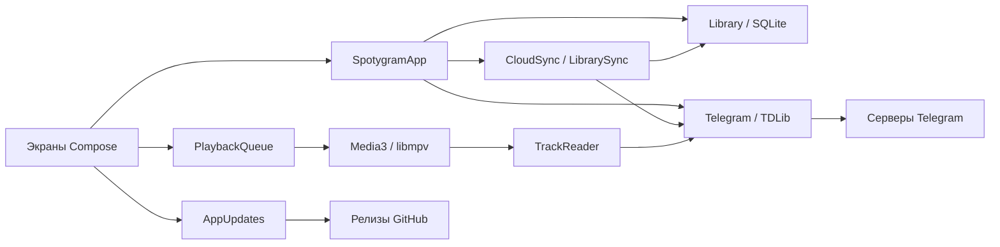

# Устройство приложения

[Документация](README.ru.md) · [English](architecture.md) · **Русский**

Spotygram работает с Telegram, музыкальной библиотекой и звуком на устройстве.
Android, Windows, Linux и macOS компилируют один код Kotlin/Compose. Платформенные
части предоставляют функции ОС и нативный звуковой движок.

Собственного сервера, локального HTTP-прокси, веб-вью и второго медиакэша нет.
Установка и расположение профиля описаны в [руководстве пользователя](usage.ru.md).
Инструменты, ключи, упаковка и публикация — в [руководстве по сборке](build.ru.md).

## Исходники и обязанности

| Часть | Отвечает за | Использует |
| --- | --- | --- |
| `shared/` | Экраны, ресурсы, каталог, запросы Telegram, очередь и правила кэша | Небольшие контракты `Platform`, `TdClient` и `Player` |
| `app/` | Жизненный цикл Android, выбор файлов, Keystore, SQLite, службы, Media3 и установку APK | Общий код приложения и API Android |
| `desktop/` | Окно/трей, активацию, системные ключи, SQLite JDBC, libmpv, медиакнопки и установку архивов | Общий код приложения и JVM/нативные библиотеки |
| `tools/` | Нативную сборку Android, закреплённые desktop-зависимости, образы и подписанные архивы | Рабочие данные сборки вне исходников |

`shared/` — каталог исходников, без отдельного Gradle-модуля или публикуемой
библиотеки. Два платформенных модуля компилируют его напрямую. Общие версии
зависимостей заданы в корневом файле сборки; зависимости движка и ОС — в своём модуле.

`SpotygramApp` координирует импорт, обнаружение источников и действия пользователя.
`Telegram` владеет одним клиентом TDLib, авторизацией и сопоставлением запросов
с ответами. `Library` владеет SQLite и неизменяемыми снимками каталога. Экраны
читают снимки, а не базу TDLib. `SpotygramUI` управляет навигацией и панелями;
отдельные файлы экранов — их разметкой. `Design.kt` задаёт общий материал стекла.

`PlaybackQueue` управляет порядком, сохранением скорости и позиций. Движки
декодируют звук и сообщают нативные события. `ListeningCache` владеет временными
копиями для прослушивания; `MusicCache` координирует явную общую очистку.
`Downloads` ведёт одну сохраняемую последовательную очередь скачивания. На Android
она работает в foreground-службе, на desktop — в приложении при скрытом окне.
Загрузчик один раз читает ожидающий список и двигает курсор. Добавление отмечает
список для перечитывания; завершение проверяет, что он пуст. Весь список не
копируется перед каждым файлом. Активная задача, включая первоначальный запрос,
сохраняет desktop-процесс при закрытии окна.

## Каталог и данные

Схема SQLite 8 хранит треки, источники чатов и профилей, плейлисты, их состав, ожидающие загрузки,
владение временными файлами и позиции длинных записей. Оба адаптера применяют
одни последовательные миграции. Позиции каскадно удаляются вместе с записью трека.
Данные синхронизации и её служебные записи привязаны к аккаунту и лежат в той же базе.
Правки плейлистов, пакетные отметки любимых, удаление сообщений и очистка записей
Telegram используют транзакции. Миграции не сбрасывают библиотеку.

Идентификатор трека из чата — `chat_id:message_id`. Профильный трек использует ID
человека и SHA-256 стабильного удалённого ключа файла TDLib. У источников чата и
профиля разные пространства ключей, даже если это один человек. Числовой ID файла TDLib
принадлежит одному времени жизни нативного клиента. Запуск и закрытие клиента
сбрасывают привязки; при необходимости сообщения или аудио профиля разрешаются заново. Стабильные
удалённые ключи определяют общие копии между запусками. Размер готового файла
должен совпадать с известным размером аудио. Проверка при запуске очищает неверные
пути каталога, не удаляя сами файлы. Ошибка открытия каталога останавливает запуск
и не может подтвердить успешную установку desktop-обновления.

Обнаружение музыки проходит аудио и подходящие аудиодокументы до конца курсоров.
У каждого источника отдельные курсоры аудио/документов и отметки новых сообщений.
Короткая страница не считается концом. Прерванная индексация продолжается без
пропуска новых записей. Она собирает метаданные, не скачивая аудио заранее.

`Profiles` отвечает за поиск людей, страницы `getUserProfileAudios` и состояние
загрузки профиля. Разбор метаданных и кодирование стабильного ключа идут вне UI-потока.
Только полный согласованный ответ меняет состав профиля одной транзакцией; ошибка,
изменение счётчика или пропущенная страница сохраняют прежний список. Чтение профиля
регистрирует нативный механизм TDLib для обновления файловых ссылок. Переносимая
карточка содержит ID и username человека; новый клиент проверяет ID при разрешении
username либо при необходимости загружает каталог контактов своего аккаунта.

Шапка меню песни проверяет `isProfileAudio` для конкретной записи. `Profiles`
последовательно выполняет явные запросы `addProfileAudio`/`removeProfileAudio` и
меняет кнопку после подтверждения Telegram. Заменяемая задача обновляет уже
открытый или подключённый свой профиль; она не задерживает кнопку и не опрашивает
аккаунт в покое. Для записей из чатов сохраняются ограничения Telegram на сохранение.
Обычные файлы Document исключены: музыка профиля требует файлов Audio.
Импортированные записи загружает нативный механизм TDLib; стабильный ключ и ссылка
на файл сохраняются в существующих колонках трека, сохраняя исходный локальный файл
и запись. Членством в профиле владеет Telegram: новой записи синхронизации библиотеки
и миграции схемы нет. Существующий foreground-сервис передачи файлов Android также
поддерживает явные загрузки в профиль; desktop сохраняет процесс при закрытии окна,
пока выполняется изменение профиля.

Просмотр хранит метаданные отдельно от членства в медиатеке. В «Музыку» и редактор
плейлистов попадают подключённые профили, любимые песни и записи из плейлистов;
копии прослушанных песен доступны в «На устройстве». Кэш просмотра сохраняет
двенадцать недавних профилей, подключённый/текущий профиль и людей из локальной очереди.
Очистка бережёт любимые, состав плейлистов, скачанные файлы, ожидающие загрузки и
закладки длинных записей. Задачи профилей отменяются перед выходом из аккаунта или
закрытием приложения. Автоматического обхода музыки всех контактов и постоянного
опроса профилей нет.

Каталогом чатов владеет TDLib. Окно добавления загружает основной список и архив
независимо от ввода, сначала показывает локальный поиск и затем дополняет его
серверным поиском с задержкой после ввода. Один ID показывается один раз;
секретные чаты исключены. События каталога объединяются за 200 мс. Задачи окна
останавливаются вместе с видимым жизненным циклом. После ошибки новая попытка
ждёт обновления, восстановления связи или нового запроса. В очередь событий
приложения попадают только обновления, используемые музыкальным каталогом.

`ChatPhotos` хранит метаданные фото только для запрошенных чатов. Видимые строки
получают маленький JPEG через `getChat` и используют файловый кэш TDLib; события
смены фото заменяют старую картинку или убирают её. Задачи аватарок чатов и профилей
делят два места и низкий приоритет загрузки. Уход со строки останавливает её работу;
восстановление связи, возврат в экран и явное обновление повторяют загрузку
недостающих фото чатов. Закрытие клиента отменяет задачи и очищает нативные ID.
Фото остаются на устройстве; новых полей схемы каталога и синхронизации нет.

`Library.reload` читает каталог и состав всех плейлистов пятью
запросами, независимо от их количества. Поиск по ID и включённая группировка дублей
готовятся на IO до публикации изменённого снимка. Группы локальных файлов кэшируются
по требованию. Все ссылки на общую обложку обновляются одной транзакцией и одним
чтением каталога. Пути проверяются один раз для каждой пары путь/размер.

Каталог остаётся в памяти: его стоимость хранения — **O(треки + связи плейлистов)**.
Поиск и фильтры проходят метаданные, сортировка стоит **O(n log n)**, перечитывание
читает весь каталог. Ленивые списки ограничивают отрисовку, а не память каталога.
Это решение соответствует проверенной коллекции; скорость на сотнях тысяч разных
записей не проверена. Границы приведены в [журнале проверок](verification.ru.md).

Скрытие дублей — обратимое представление «Музыки», «Любимых» и «На устройстве».
Снимок объединяет стабильные ключи, общие пути и точные нормализованные
название/исполнителя/длительность/размер, без хеширования файлов и попарных сравнений.
Для сопоставления метаданных нужны известные длительность и размер. Фильтры идут
до выбора сохранённой локальной, временной локальной или доступной удалённой копии.
Любимые и подсветка учитывают скрытые ссылки; Undo возвращает точные прежние отметки.
Явные плейлисты и очереди сохраняют состав. Скрытые копии входят в объём хранения.

Импорт создаёт собственную копию. Копирование проверяет отмену между блоками;
неудачный импорт удаляет подготовленные аудио и обложку. После записи в SQLite
ошибка перечитывания или уведомления сохраняет файлы. Удаление убирает запись
каталога только после фактического удаления её локальных файлов.

## Автоматическая синхронизация библиотеки

`LibrarySync` хранит переносимые пользовательские данные и признаки ожидающей
отправки. Действие пользователя меняет каталог и данные синхронизации в одной
транзакции SQLite. У плейлистов есть стабильные UUID, независимые от местного ID.
Карточки треков содержат метаданные и ссылки на сообщения или профили Telegram, без местных
путей и нативных ID файлов. Поэтому любимые и состав плейлистов доступны до
индексации. Импортированное аудио остаётся локальным; другое устройство получает
карточку недоступной записи.

Версия поля состоит из логического счётчика и UUID устройства. Получение версии
продвигает местный счётчик; при равенстве используется UUID автора. Повторные
отправки и чтения сходятся к одному состоянию. Членство в плейлисте имеет отдельную
версию для каждой песни; перестановка сохраняет параллельные добавления. Записи
об удалении переживают снимки и не дают старому устройству восстановить удалённый
плейлист. Первая миграция сохраняет существующие плейлисты, любимые, источники,
карточки используемых треков и настройки. Схема 7 убирает облачные записи очереди
и прогресса, сохраняя локальные настройки очереди и закладки. Поля объектов JSON
кодируются в отсортированном порядке для равенства данных Android и desktop. Выход отсоединяет
данные аккаунта, не отправляя местную очистку как удаление общей библиотеки.

`CloudSync` ищет канал и управляет одним IO-процессом с объединением событий.
Он загружает оба списка чатов и проверяет каналы владельца по маркеру описания,
привязанному к аккаунту, включая переименованные каналы. Если два первых запуска
создали разные каналы, клиенты выбирают один общий, продолжая читать остальные.
Канал получает случайное название с `spotygram-`, постоянное отключение уведомлений,
архивирование и запрет автоудаления сообщений. Отправки тихие; `openChat` даёт
живые события. Запуск и восстановление связи сверяют историю. Постоянного опроса
нет. Серверные задержки и ограниченное увеличение интервала повторов сохраняют
ожидающие правки. Недоступный запомненный канал вызывает ошибку доступа.

Документы gzip/JSON содержат формат, аккаунт и версии записей; подпись сообщения
содержит SHA-256 файла. Небольшие пакеты передают изменения. Формат 3 добавляет
подключённые профили и ссылки на их аудио, читая форматы 1 и 2 без облачного
воспроизведения. Клиенты до 0.18.0 включительно приостанавливают обмен после получения
формата 3 до обновления. Полные снимки исключают карточки, использовавшиеся только
при воспроизведении или просмотре профиля. При первом запуске
и большом количестве ожидающих записей создаётся полный снимок. Одно отложенное
событие сворачивает изменённый канал через 60 секунд; 16 документов в хвосте
общей истории запускают сворачивание раньше, независимо от автора. Постоянного
опроса пустого канала нет. Граница `through` позволяет удалить только уже включённые
сообщения протокола из этого канала. Ожидание очистки сохраняется и снимается
только после успешного удаления; восстановление связи продолжает её. Версии и
записи об удалениях остаются в снимке. Только финальный
результат отправки TDLib снимает ожидание с отправленных версий; более новые
правки остаются в очереди. Входящий набор целиком проверяется до одной транзакции
применения. Неизвестный формат и повреждённый документ сохраняют каталог и правки.
Размер ограничен 8 МиБ в сжатом виде и 32 МиБ после распаковки. Скачанные документы
и временные файлы отправки удаляются после использования.

Настройки библиотеки применяются через общие действия приложения. Скорость, порядок,
повтор, громкость и выключенный звук остаются локальными вместе с очередью,
последним треком и позициями. При запуске старые записи скорости/порядка/повтора
удаляются из локального хранилища синхронизации; при получении они игнорируются,
не мешая остальной библиотеке. Расширение профилей использует формат 3 и читает
прежние записи библиотеки. Пятисекундные сохранения, пауза, перемотка, смена записи и обычный
выход записывают только локальное состояние. Копии аудио, загрузки, курсоры индексации, нативные сессии
и состояние установки относятся к конкретному устройству. Канал использует обычную
облачную защиту Telegram; отдельного ключа шифрования нет.

## Воспроизведение и сохранение

Полная очередь находится в `PlaybackQueue`. Движок получает максимум предыдущую,
текущую и следующую записи. Android откладывает сдвиг окна до завершения перехода
Media3, чтобы контроллеры видели согласованную очередь. Записи используют индексы
подборки, позволяя намеренные повторы. Перемешивание использует Фишера — Йетса
и хранит максимум два прохода. Повтор всей подборки не повторяет песню на границе
перемешанных проходов. Абсолютный рандом выбирает независимо и хранит 32 предыдущих
выбора, текущий и один подготовленный следующий.

Обратный порядок проходит индексы подборки от большего к меньшему. Смена режима
сохраняет выбранную песню и позицию. Вставка следующей записи и перемещение вверх
следуют отображаемому порядку очереди; библиотека и плейлисты сохраняют собственную
сортировку. Локальные настройки режима независимы от сохранённой очереди, в том
числе пустой.

Один IO-писатель объединяет ожидающие неизменяемые снимки. Структурные изменения
пишут весь список; позиция, режим и курсор — отдельные настройки, связанные версией.
Контрольная запись раз в пять секунд и события паузы/перемотки/выбора/жизненного
цикла сохраняют изменённые позиции длинных записей одной транзакцией. Дослушивание
удаляет позиции, включая повтор одного трека. Изменённые ключ/размер и позиция за
пределами длительности запрещают продолжение. Восстановление остаётся на паузе
и ждёт проверки каталога и загрузки позиций.

Скорость — 0,3×–4× с сохранением высоты тона. Отложенная на 300 мс запись настройки
объединяет движения ползунка; закрытие очереди сохраняет её сразу. Смена скорости
не перестраивает очередь.

Desktop libmpv регулирует программную громкость от 0 до 100%. Полный плеер и панель
мини-плеера наблюдают одни события движка. Выключение звука сохраняет последний
ненулевой уровень. Отложенная на 300 мс запись объединяет изменения громкости;
закрытие движка сохраняет их сразу. Эти настройки хранятся только в desktop-профиле.

`TrackReader` читает готовые диапазоны файлов TDLib для обоих движков. Недостающие
части ждут нативных событий, с таймаутом чтения 60 секунд. Замена или закрытие
отменяет ожидание. Ошибка чтения останавливает воспроизведение, не превращаясь
в успешный конец файла и не удаляя позицию. Файловый канал NIO позволяет TDLib
переименовать завершённую загрузку в Windows при открытом чтении; чтение по позиции
продолжается через тот же дескриптор. Media3 целится в буфер 15–30 секунд;
libmpv читает вперёд до 30 секунд в пределах 8 МиБ демультиплексора. Это настройки,
а не измеренные обещания задержки.

Android `PlayerConnection` существует от Activity STARTED до STOPPED. У попытки
таймаут десять секунд и один автоматический повтор. Последний ожидающий выбор
выполняется один раз после подключения. Уход отменяет ожидание, а уже играющая
музыка продолжается. Поколения callback отсеивают старые контроллеры. Обработчики UI
с меняющимися захваченными значениями используют лямбды, а не ссылки на функции
с устаревшими захватами.

Desktop использует одну блокировку профиля, события файловой активации и медиакнопки
Nucleus: MPRIS, SMTC и MPNowPlayingInfoCenter. Nucleus передаёт команды в UI-поток
Swing. Play идемпотентен, в том числе при буферизации; Toggle переключает состояние.
Скрытие и сворачивание останавливают наблюдения UI и поиск чатов. Выход сохраняет
воспроизведение и настройки и закрывает нативные ресурсы до освобождения
блокировки профиля.

На desktop команды Play/Pause определяют намерение пользователя. Временная
нативная пауза при загрузке другого файла не меняет его. События файла привязаны
к записи нативной очереди и поколению загрузки; замена потока отменяет ожидающие
чтения. Длительность и буферизация обновляются по значениям нативных событий.
Событие возобновления воспроизведения libmpv подтверждает завершение перемотки.
Позиция аудиочасов может отличаться от запрошенной из-за задержки вывода и скорости;
её совпадение не служит условием завершения. Новая перемотка отсеивает обработку
старого возобновления, уже ожидающую в очереди UI-потока.

## Владение файлами и защита аккаунта

По умолчанию готовые файлы Telegram остаются для офлайна; оптимизатор хранилища
TDLib отключён. Временное прослушивание использует `temporary_audio` со стабильным
удалённым ключом. Старые копии, импорт и явные загрузки остаются сохранёнными.
Рабочее окно очереди и открытые чтения защищают файлы; mutex на файл разводит
открытие и удаление. Явное скачивание закрепляет известные ссылки и снимает временное
владение. Отключение режима сохраняет оставшиеся копии из журнала.

Очистка следует событиям, без таймера и сканера каталогов. За проход — максимум
четыре подходящих файла. Она разрешает нативный ID, перепроверяет защиту, записывает
фактический путь, отменяет загрузку, удаляет через TDLib и проверяет нативное
состояние и отсутствие файла до удаления записи владения. Ошибки сохраняют журнал;
повтор по следующим событиям доступен не раньше минуты. Это политика рабочего
набора, без строгой квоты байт или воспроизведения только из RAM.

Общая очистка кэша ждёт автоматическую, останавливает плеер/загрузки и ждёт чтения.
TDLib удаляет аудио/документы, в том числе явно сохранённые; импорт остаётся.
Одна транзакция сверяет отсутствующие пути, затем логическая очередь возвращается
на паузе. Любимые, плейлисты и вход сохраняются. Позднее завершение загрузки
проверяет файл до повторной отметки офлайна.

Случайный ключ базы TDLib оборачивается AES-GCM Android Keystore или хранится
в Windows Credential Manager, macOS Keychain либо Linux Secret Service. Потеря
ключа существующей базы не приводит к его замене. При запуске приложение сначала
читает ключ, затем создаёт папки базы и файлов Telegram и передаёт TDLib абсолютные
пути в формате ОС. Создание папок выполняется на IO. Резервное копирование Android
отключено. Каталог и аудио лежат в приватном хранилище без отдельного шифрования
каждого файла. Вход создаёт полную сессию Telegram; выбор источников ограничивает
индексацию, а не права аккаунта. Выход удаляет записи Telegram и ссылки плейлистов
на этом устройстве, сохраняя импорт и данные синхронизации аккаунта. Сетевые данные
не записываются в логи.

При незавершённом входе по телефону «Назад» открывает ввод номера, сохраняя реальное
состояние TDLib: ожидание кода, пароля или почты. Другой номер отправляется через
`setAuthenticationPhoneNumber`, без выхода и сброса каталога. Ошибка оставляет поле
номера доступным. Для ожидающего QR-входа используется существующий перезапуск
незавершённого клиента: TDLib не умеет прямо заменить это состояние номером.
Системная кнопка назад Android, Esc на desktop и стрелка работают одинаково.

`Telegram` выполняет запросы авторизации по одному и сохраняет полученные от сервера
номер, способ доставки, следующий способ и срок повторной отправки по монотонным
часам. Экран отсчитывает время только пока виден; автоматической повторной отправки
нет. Ввод привязан к показанному шагу и номеру получателя: задержавшийся кадр не
может отправить номер как код, если TDLib уже перешёл к следующему шагу. Для повторной отправки
нужны и следующий способ, и истёкший срок. Пропущенный звонок разрешён,
поскольку последние цифры номера можно ввести вручную; поддержка flash-call,
SMS Retriever и Firebase не заявляется.

## Визуальная система и работа в покое

Строки ENG/RU хранятся в общих XML. Медовый стеклянный знак с округлыми ушами
и антенной-завитком — один прозрачный PNG в `shared/`; Android и desktop загружают
одинаковое изображение. В интерфейсе название пишется как `spotygram`. Системные
иконки помещают знак на светлую подложку liquid glass. Упаковка desktop получает
PNG, ICO с несколькими размерами и ICNS из общего `spotygram_launcher.png`;
окно и трей используют эту же плитку. На Android отдельный знак остаётся в переднем
слое адаптивной иконки с пропорциональными отступами безопасной области, а стеклянная
подложка продолжена за пределы маски лаунчера.
Белый силуэт сохранён для тематических иконок и уведомлений. Блики уже входят
в изображения, поэтому этим ресурсам не нужны размытие или анимация в приложении.

`Design.kt` передаёт явные захваты фона/содержимого в Haze Glass 2.0.1.
Элементы управления находятся вне своего захвата; плотное стекло
рассеивает текст под ним. Основное преломление края, дисперсия и свет сохранены,
вторичный проход деталей отключён. Эффектов на строках и анимированных обоев нет.
Desktop и Android 13+ используют полную оптику; старый Android — более плотный tint,
свет и край. Compose/Haze учитывает системное уменьшение движения.
Неизменные градиенты окружения и края кэшируются до изменения размера или темы.
Windows использует штатный путь Direct3D в Skiko: рисование и вывод кадра работают
вне потока событий интерфейса. Если нет аппаратного адаптера DXGI с поддержкой
Direct3D 12, стартовая проверка выбирает ANGLE: он оказался быстрее программного
Direct3D в нативных замерах.
Выбор происходит до создания окна. Явный выбор
другого рендерера средствами Skiko сохраняется; оба пути используют общий материал стекла.

От 840 dp навигация переходит в боковую панель, а широкий плеер разделяет обложку
и управление. Список ограничен 720 dp. Узкие панели и увеличенный шрифт используют
иконки со вторичными зонами касания 48 dp. Стекло листа находится внутри его
нативного сдвига; изменения при клавиатуре сохраняют поля ввода и фокус.

Действия песни используют общую шапку и список. Кнопка «В профиль» / «Убрать»
находится по центру под строкой обложки и названия, сразу выполняет действие
и имеет зону касания не менее 48 dp. Её ширина вмещает более длинную подпись при
текущем размере шрифта и одинакова в обоих состояниях. Экранный диктор получает
полные описания действий.
От 600 dp меню привязано к кнопке с тремя точками выбранной песни; на узких окнах
используется нативный нижний лист. Обе поверхности ограничивают высоту и прокручивают
длинное содержимое.

В «Источниках» ленивые строки находятся внутри общих стеклянных панелей. На каждую
видимую группу приходится одна поверхность в пределах окна, в том числе когда
группа выше экрана. В выборе источника поиск и управление остаются вне прокрутки;
текущий выбор сразу виден, а в широком меню строки плотнее. Внутренние стеклянные
поверхности используют только захват окружения: текст библиотеки не просвечивает
через названия и поиск. На узком экране используется существующий нижний лист,
от 600 dp — меню рядом с кнопкой.

SQLite, копирование, метаданные и разбор страниц работают вне UI-потока. Индексация
публикует снимки не чаще двух раз в секунду плюс по завершении. Таймеры UI принадлежат
видимым компонентам плеера. Android сообщает события сети; desktop TDLib управляет
переподключением. Проверка Wi-Fi на desktop работает только во время явных загрузок.
Сетевого опроса в покое нет. Встроенная Java ограничивает heap до 256 МиБ; нативная
память звука, Telegram и графики находится за пределами этого ограничения.

## Доверие к обновлениям и установка

`AppUpdates` делает один запрос при входе на передний план к фиксированному публичному
GitHub endpoint последнего релиза. Попытки сохраняются до сети: 24 часа автоматически,
минута вручную, с сохранённым ограничением GitHub. ETag/304 использует действующие
метаданные; таймауты 5/8 секунд, предел ответа 256 КиБ и запрет перенаправлений
ограничивают проверку. Принимаются только обычные числовые релизы с точным файлом
платформы. Скачивание требует явного действия.

На Android загрузкой владеет DownloadManager; прогресс опрашивает только активная
Activity. Проверка приватного APK сверяет размер, GitHub SHA-256, пакет/версию,
рост versionCode и действующие сертификаты. Неэкспортируемый FileProvider выдаёт
чтение только проверенного APK. Разрешение неизвестного источника и установка
используют штатный UI Android; отказ и отмена не запускают новые окна автоматически.

Desktop-установщики упаковывают готовый jpackage-образ: пользовательский EXE Inno Setup с
ярлыками и постоянным идентификатором обновления, Ubuntu DEB с записью меню и DMG
со ссылкой Applications. Ресурс образа выбирает обновление нативным пакетом;
отдельного приложения или профиля нет. Такие обновления проверяют GitHub SHA-256
и отдельную подпись прежнего Ed25519-ключа над точным именем пакета и digest,
затем по подтверждению открывают системный установщик. ОС управляет установкой
и удалением; удаление сохраняет отдельный профиль. Файлы Windows по умолчанию
в `%LOCALAPPDATA%\SpotygramApp`, данные — в `%LOCALAPPDATA%\Spotygram`.

Windows EXE находит прежнее MSI-семейство текущего пользователя и удаляет
соответствующие продукты Spotygram перед установкой, сохраняя папку программы.
При записанной в лог ошибке `Config.Msi` 1926 или 1314 это удаление повторяется
один раз с `DISABLEROLLBACK=1`; системные политики и права на диске не меняются.
Неудача останавливает установку и показывает путь к логу. Последующие установка
и удаление используют Inno Setup и не зависят от отката Windows Installer.
Старым MSI-клиентам нужен один ручной запуск скачанного EXE: их updater ожидает MSI.
После установки новых файлов мастер убирает устаревшие JAR, перечисленные в
прежнем конфиге launcher Spotygram. Это очищает библиотеки, оставшиеся после
неудачного удаления MSI; файлы вне прежнего classpath сохраняются.

Переносной desktop продолжает загрузку и проверяет SHA-256, подпись Ed25519, платформу, версию
и все извлечённые файлы. Распаковка ограничивает пути, ссылки, число записей и объём,
включая копии жёстких ссылок. После подтверждения помощник из кэша ждёт старый процесс
и готовит проверенную замену на файловой системе программы. Если новый launcher
не запускается либо каталог не подтверждает запуск, возвращается прежнее приложение.
Профиль и ключи находятся вне заменяемого дерева. На Windows остановка неудачного
запуска или отмена помощника завершает launcher и дочерние JVM до освобождения
их файлов. macOS имеет ad hoc подпись;
доверие к издателю обновлений даёт подпись манифеста. Нотариализация Apple не настроена.

Точные имена файлов и требования к ключам — в [руководстве по сборке](build.ru.md).
Наблюдения и оставшиеся границы — в [журнале проверок](verification.ru.md).
