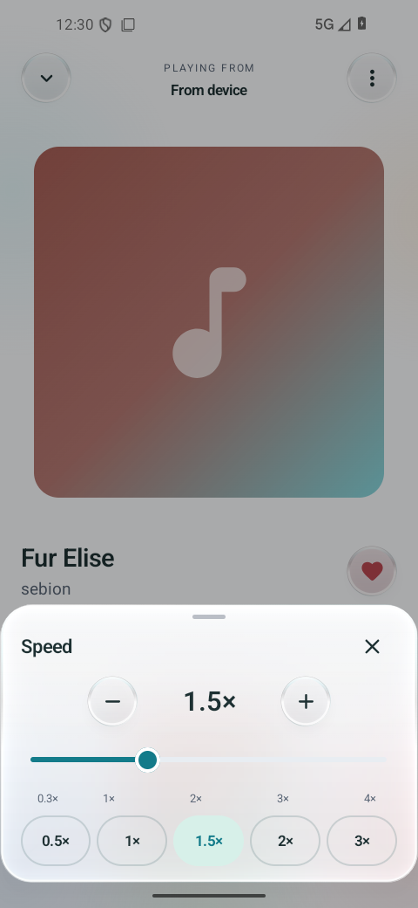

# Using Spotygram

[Documentation](README.md) · **English** · [Русский](usage.ru.md)

Spotygram brings audio from selected chats into a music library. Messages stay
in Telegram; favorites, playlists and downloaded copies live on your device.

## First launch

On Android, install the ARM64 APK from the [latest release](https://github.com/Krablante/spotygram/releases/latest).
Android may ask you to allow installation from the browser or file manager
opening the APK. Android 8.0 or newer is required.

On Windows, install the EXE and launch from Start. On macOS, open the DMG and drag
Spotygram to Applications. On Ubuntu, install the DEB and launch from the applications
menu. The [installation instructions](../README.md#put-it-on-your-computer) give
requirements and the portable alternative. Java and native libraries are included.

Sign in with your Telegram number in international format (`+`, country code,
number), or scan the QR code from Telegram's **Settings → Devices → Link Desktop
Device**. Spaces, brackets and dashes are accepted; `00` also works as the
international prefix. Published packages do not require developer API keys.

The code screen shows the number Telegram received and the delivery method it
selected. For a Telegram code, check the service chat on a device already signed
in to that number. Telegram controls delivery and may delay or suppress a code.
Resending becomes available after its countdown, if Telegram offers another
delivery method. The button identifies SMS or a phone call when offered. For a
missed call, do not answer; enter the indicated number of final caller digits.
If no code arrives, QR login is also available directly on this screen. Repeated
new requests can trigger Telegram's limits. If you use a two-step verification
password, enter it after the code.

Entered the wrong number? On the code, password or email screen, use the back arrow,
Android Back, desktop Esc or **Change phone number**. Enter the other number and
choose **Continue** to request its code. An invalid number stays editable with an
error message. **Open local music** leaves sign-in for the local library.

You can skip Telegram and start with local files. **Settings → Import audio files**
opens the system file picker. Android also accepts audio shared from another
app; desktop accepts files passed to its launcher and **Ctrl/⌘+O** opens its picker.
Importing creates a separate copy in the player's library.

## Add music from chats

Open **Chats → Add chats**, choose Saved Messages, groups or channels, then
confirm your selection. An accessible public channel can also be added by
`@username`. Spotygram does not automatically subscribe you to it.

Private channels accessible to the connected account can be selected by name;
they do not need a public username. The picker searches loaded chats immediately
and adds online matches when available. Typing does not stop the chat list from
loading, and newly received chats can appear while the picker stays open.
Use the refresh icon **inside Add chats** to retry directory loading and search.
Offline, already loaded chats remain selectable. The refresh button on the
main Chats screen updates music in sources you have already selected.

History loads progressively: you can listen to the first songs while more
appear. The app scans all accessible history, not just the last hundred
messages. Interrupted loading resumes from its saved position. Use refresh
or pull down to update the list; unfinished history can be resumed.

Library search uses music already found. If a song is missing, **Search selected
chats** searches Telegram. Secret chats, voice notes and videos are excluded
from the music library.

## Listen

**Settings → Hide duplicates** is on by default. Music, Favorites and On device
show one entry per matching recording. Turn it off to see separate entries
again; nothing is deleted.

Tracks match by Telegram file identity, a shared local path, or equal title,
artist, duration and file size. Case and extra whitespace are ignored; a title
alone is insufficient. File contents are not compared, so this is not acoustic
recognition. Search and source filters run first; a retained local copy is
preferred among matching candidates.

The heart reflects favorites across the group. Removing it clears those marks
together; Undo restores the exact previous marks. New queues launched from the
list get one representative per group. Existing playlists and the current queue
are not rewritten; independent draws in absolute random can still repeat.

The four bottom destinations are **Music**, **Favorites**, **Playlists** and
**Chats**. Your last destination is remembered. Tap a song to play; the small
bottom player opens the full player. Android lock-screen and desktop system media
controls work too. Wide windows move navigation to the side.

Desktop **Esc** closes the current panel or player. Closing the window while
playing or downloading hides it in the tray, or minimizes it when a tray is
unavailable. **Ctrl/⌘+Q** quits and saves state; playback never starts automatically
after the next launch.

The mini-player has previous, play/pause and next buttons. Previous switches
directly to the previous song without opening the full player.

If the player is still connecting after you return, the selected song starts
when it is ready. Repeated taps keep the latest selection. If connection fails,
the message asks you to tap a song to retry; restarting the app is not required.
Leaving the app cancels a waiting start, but does not stop music already playing.

The full player has seeking, a queue and repeat controls. The order button to
the left of Previous cycles through three modes:

| Mode | How the next song is chosen |
| --- | --- |
| In order | The next entry in the collection |
| Shuffle | A random order with no repeats within a pass |
| Absolute random, the dice icon | An independent draw every time; even consecutive repeats are possible |

Random mode continues until stopped. Previous retraces recent listening
history. The queue shows the selection pool and the next prepared song, not
a promise to play the whole collection in order. **Play next** in a song's menu
takes priority over the random choice.

Repeat one works in all modes. Repeat all works in ordered and shuffled modes;
random is already endless. Reopening the app restores the queue and position
without starting playback automatically.

Tap the round speed button between **Download** and **Queue** in the full player.
The slider covers **0.3×–4×**; **− / +** adjust by 0.05×. Quick choices are
0.5×, 1×, 1.5×, 2× and 3×. Changes apply immediately without a confirmation
button; close the panel with its cross, Back or a tap outside it.

The chosen speed keeps the original pitch and applies to subsequent songs,
including after an app restart. **1×** restores normal speed. The button gains
a subtle accent and the mini-player shows the value whenever speed differs from 1×.

## Continue long recordings

**Settings → Remember audio positions** is enabled by default for audio
**30 minutes or longer**. Tap **Audio duration threshold** to enter your own positive
whole number of minutes. The threshold uses the recording's original duration,
regardless of playback speed, and includes recordings exactly at the threshold.

Each library entry keeps its own position. Selecting it from Music, a playlist
or the queue, or returning with Previous/Next, resumes there. Pausing and seeking
update the position; listening in the background also saves it periodically.
Reopening restores the queue without starting playback automatically. Short
tracks retain the existing current-queue restoration, but a fresh selection
starts them from the beginning.

Finished recordings and repeat-one loops start from the beginning. To restart
an unfinished recording, move its seek slider to the beginning or use the full
player's Previous button while more than three seconds into it. Changing the
threshold or disabling the feature retains existing positions for later use;
disabled playback does not save new ones. Finishing a recording still clears its
old position. Deleting a Telegram download leaves its position intact; removing
the library entry or signing out removes the corresponding positions.

Positions are saved about every five seconds while playing and immediately on
pause, seek and track changes. An abrupt process kill can lose progress since the
last completed save. Recordings with unknown duration qualify once the player
learns their length. Positions belong to this device. Pausing, seeking and changing
tracks save locally without publishing playback data to Telegram.

## Favorites and playlists

The heart beside a song adds it to **Favorites**. Tap again to remove the mark;
the resulting message offers Undo. The file stays in place and playback
continues.

In **Playlists → New playlist**, enter a name and select songs. You can create
an empty playlist and add music later through its add-tracks action.

Long-press a song or tap the checklist icon beside the playback buttons
(**Select**) to choose several songs at once. Taps then
select rather than play. Searching does not discard your existing selection.
Back exits selection first.

Open a playlist's action menu, or long-press the playlist, to rename, delete
or reorder it. In the ordering view, hold the handle beside a song and drag;
up/down arrows are also available. Removing a song from a playlist or deleting
the playlist does not delete the audio files.

## One library across devices

Sign in to the same Telegram account on each device. Spotygram automatically
creates or finds a private channel named `spotygram-` followed by random characters,
mutes it and moves it to Telegram's archive. It stays out of the music-source picker.
You do not need to choose files or start a sync manually.

Playlists, their song order, favorites, selected chats, playback preferences,
appearance and language sync automatically. Each device keeps its own queue,
last track and listening positions. Playback itself does not send sync documents.
Referenced songs appear before their source finishes indexing. Imported songs
retain their place in playlists, but their audio stays on the device that imported
it; a metadata entry alone cannot make such a song playable elsewhere.

Edits save locally first and send in small batches. Offline edits survive closing
the app and send after reconnection. Different song additions are kept together.
Conflicting edits of the same field resolve consistently using their saved
versions; a deleted playlist cannot return through an older device's edits.
Separate existing playlists keep their identities even when their names match.

The storage channel keeps a current full snapshot and a short tail of recent edits.
Connected clients consolidate that tail within about a minute or when it grows,
then delete the replaced documents. Interrupted cleanup resumes after reconnection.
Update every device to **0.17.0 or later**. Older versions pause sync when they encounter
the new format; upgrading restores library sync while retaining local playback data.

**Settings → Library sync** shows the current state and offers Retry after an
error. Sync runs while Spotygram is running and Telegram is connected; a closed
device catches up on its next launch. Downloaded files, native sessions, download
jobs, indexing cursors and update-installation state remain device-specific.

The channel uses Telegram's ordinary cloud protection, without a separate key
or device-pairing step. Keep it private and accessible. Deleting it prevents new
devices from restoring its contents; an already connected device keeps its local
data and reports the unavailable storage. Signing out clears that device's
Telegram catalog without deleting the shared library.

## Listen offline

By default, a fully downloaded song gains an offline icon and stays on the device. Use
**Download** on a song or collection to save music in advance. Settings lets
you restrict these downloads to Wi-Fi and resume interrupted downloads.
The Wi-Fi restriction does not apply to ordinary playback.

The download icon beside the source selector toggles **On device**; its highlight
and the On device heading show when the filter is active. It shows retained local
files, excluding temporary playback copies. When several messages reference one
physical file, it always appears once. With Hide duplicates enabled, matching
separate copies are grouped too. Storage size in Settings still includes all
retained files, including hidden copies: hiding rows does not free space.
Search and source filters may narrow the list further.

## Listen without keeping every song

Enable **Settings → Do not keep played tracks** to use temporary playback copies.
It is off by default. Previously saved files, explicit downloads and imported
audio remain saved. Temporary copies have a clock icon; **Save on device** in
the player or song menu keeps a copy without downloading it again.

The current, previous and prepared next files remain while the player needs
them. Older temporary copies are removed when no reader uses them. Going
further back may require another download and internet access. Telegram still
uses temporary disk files; this is not RAM-only playback or a strict storage cap.
If cleanup is deferred, Settings offers Retry. Turning the mode off keeps the
remaining copies; it cannot restore those already deleted.

## Free up space

**Remove from device** in a song's menu removes its local copy, not the Telegram
message. Files still in the player's working window or being read cannot be removed.

**Settings → Clear music cache** shows space occupied by downloaded Telegram
audio. Imported files are excluded from that total.

**Cleanup also removes songs you explicitly saved with Download.** Playback
copies and explicit downloads share Telegram's storage. This manual action has
a broader scope than automatic removal of temporary copies. The confirmation
asks to stop playback and clear them; playback and downloads stop, and the
result reports the space freed.

Favorites, playlists, imported files and sign-in remain. Downloading again
requires access to the original message: if it is gone, the deleted copy may
not be recoverable. Cleanup requires a connected Telegram account.

## Language and appearance

The interface follows your system language: English or Russian, with English
for other languages. **Settings → Language** offers English, Russian or the
system language on every supported platform.
Song and chat names are not translated.

Choose light or dark appearance in Settings. Until then, the app follows your
system. Switching appearance does not interrupt playback.

## Updates and keeping your data

Automatic checks are enabled by default. They happen only when opening or
returning to the app, at most once a day. Failed checks count as attempts.
When there is no newer version, the app stays silent.

The update banner offers **Download and install**, also available in Settings.
Its close button dismisses that version; the offer remains in Settings.
Settings also lets you disable automatic checks or **Check for updates** manually. Repeated
manual attempts have a one-minute minimum interval, longer if GitHub limits
requests. Prereleases are excluded.

After you tap the button, Android's DownloadManager fetches the APK for your
device. The app shows progress and cancellation; the transfer can continue
while Spotygram is closed. Reopening picks up its current state.

Before installation, the app checks size, SHA-256, package, version and signing
certificate. If Android asks to allow installation from Spotygram, enable it
and return; the app continues to the installer. Denying permission does not
cause repeated prompts. **Install update** lets you try again later. Android
still requires your confirmation to install.

A ready APK can be installed again without another download, or deleted in
Settings. Cancellation removes temporary files; a successful update cleans up
the APK on the next launch. **View release** remains available for reading the
changes on GitHub. Automatic checks only offer updates: they never start a
download or installer by themselves.

Installed desktop copies download the matching EXE, DMG or DEB and verify its digest
and release signature. **Close and open installer** hands it to the OS. Complete
installation, then launch Spotygram normally. Linux needs a software installer
associated with DEB files; alternatively install the downloaded package with `sudo apt install ./FILE.deb`.

Windows MSI versions 0.15.2–0.15.4 need one manual download of the latest EXE from
[Releases](https://github.com/Krablante/spotygram/releases/latest). Run it under the
same Windows account; it removes the old MSI and preserves your profile. Later
updates use the in-app installer normally.

Portable copies download a signed archive, verify its contents and offer a restart.
The app replaces its program files and reopens with the same data, paused. Its parent
folder must be writable. Hiding the window keeps a transfer running; incomplete
transfers resume on launch, and Cancel removes them.

**Open message in Telegram** uses the normal message link where available.
Personal chats on desktop open Telegram Web K; sign in there with the same account
to see the selected message.

Installing a new official APK
over the old one preserves data. **Uninstalling the Android app removes its library
and settings.** On Windows, remove Spotygram through **Settings → Apps**; on macOS,
move the installed app to Trash; on Ubuntu, use your software manager or `sudo apt remove spotygram`.
Desktop removal preserves the separate user profile, imported music and sign-in.
Deleting a portable application folder has the same effect. Library changes already
sent to Telegram return after sign-in, including after Android reinstallation.

Telegram sign-in creates a full account session, not access restricted to the
chosen chats. You can revoke it from the official Telegram app's device settings.

## Where your data lives

Desktop keeps its profile outside the application folder:

| System | Profile |
| --- | --- |
| Windows | `%LOCALAPPDATA%\Spotygram` |
| Linux | `$XDG_DATA_HOME/spotygram`, or `~/.local/share/spotygram` when unset |
| macOS | `~/Library/Application Support/Spotygram` |

The profile contains `library.db`, `imports/`, `preferences/` and `telegram/`.
Update downloads use the OS cache folder. Android keeps its profile in private
app storage and disables system backup; uninstalling removes it.

To back up a desktop profile, quit Spotygram first and copy the whole profile
to private storage. Restore it at the same path while the app is closed.
The Telegram database key stays in the OS credential store and is not included
in that folder copy. A profile backup is therefore not a portable Telegram
session, and cannot recover a session whose credential-store key is lost.
Keep your original imported files too: library sync does not upload their audio.
`SPOTYGRAM_STATE` controls developer build files, not this user profile.

## When something goes wrong

| Symptom | What to do |
| --- | --- |
| Windows 0.15.2 cannot initialize the Telegram database | Install the latest release over it. Keep `%LOCALAPPDATA%\Spotygram` and its saved credential-store key. The fix creates the missing Telegram directories. |
| Windows removal repeats a `Config.Msi` file-security error | Close the stalled installer and run the latest EXE as described below. It replaces the old MSI with its own uninstaller. |
| Telegram sign-in on Linux reports a key-store error | Start and unlock a Secret Service provider, such as GNOME Keyring or KeePassXC with Secret Service enabled. Restart Spotygram and retry. |
| macOS blocks first launch | Use **Privacy & Security → Open Anyway**, as described in the [installation guide](../README.md#put-it-on-your-computer). |
| A song is absent | Refresh its selected source. Use **Search selected chats** if the library has not found it yet. Check that it is audio or an audio document, not a voice note. |
| An interrupted download stays paused | Check connectivity and the Wi-Fi-only setting, then resume downloads in Settings. |
| Remove from device reports that audio is in use | Select another collection so that file leaves the player's current, previous and next working set. Retry removal. |
| Desktop cannot install an update | Installed copy: complete the OS installer; on Linux, check the DEB file association or use `sudo apt install ./FILE.deb`. Portable copy: quit, move the full application to a folder with a writable parent, relaunch and retry. |
| The library cannot open | Close and reopen the app. Keep its profile and the error details; do not clear app data as a troubleshooting step. An older app cannot open a newer database schema. |

### Windows Installer cannot remove an older version

Quit Spotygram and cancel its stalled removal. If its error dialog keeps returning,
end that **Windows Installer** task in Task Manager. Download the latest
`spotygram-…-windows-x64.exe` from [Releases](https://github.com/Krablante/spotygram/releases/latest)
and run it under the same Windows account. The wizard removes the old MSI before
installing the new version. It handles the known rollback-folder errors without
changing drive permissions. After installation, **Settings → Apps → Spotygram →
Uninstall** uses the new uninstaller and keeps your profile and saved key.

If Windows already lost the old installation's registration, enter its previous
program folder on the wizard's directory page. The default is
`%LOCALAPPDATA%\SpotygramApp`. Setup replaces the remaining program files there.

If migration cannot complete, the wizard stops and shows the log path under
`%LOCALAPPDATA%\Spotygram\cache\installer`. Keep that log for diagnosis; review it
before sharing because it contains usernames and file paths. Keep the profile.

For a reproducible problem, include the app version, operating system, action
and displayed error in a [GitHub issue](https://github.com/Krablante/spotygram/issues).
Keep phone numbers, Telegram sessions, private chat names and your library out
of public reports. Developers can collect runtime logs as described in the
[build guide](build.md#manual-development).
