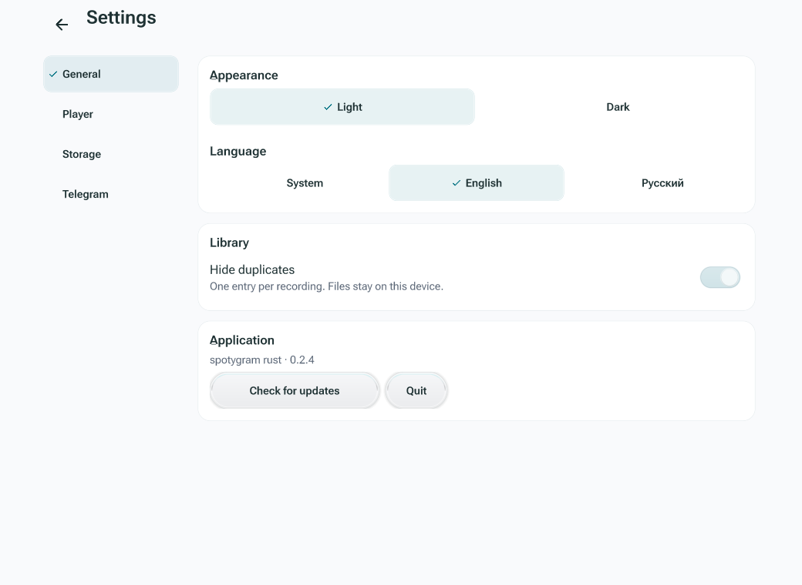
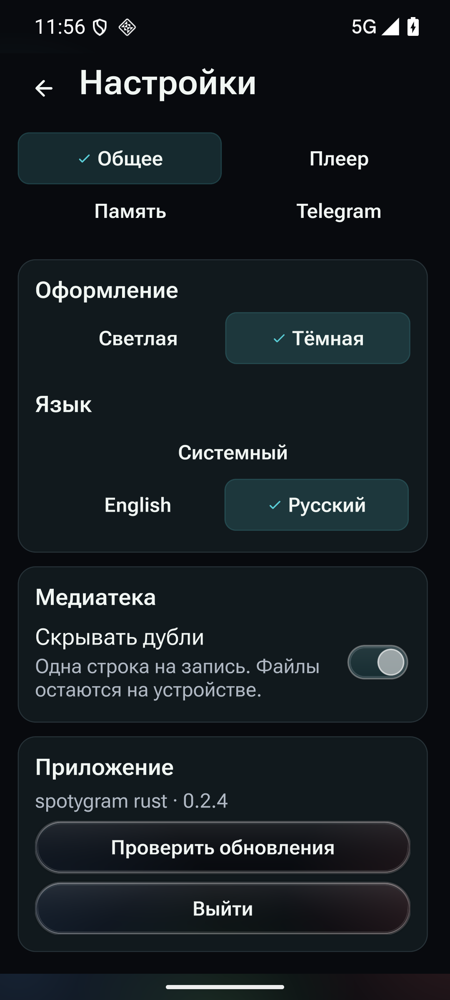

# Using the Rust preview

[Documentation](README.md) · **English** · [Русский](usage.ru.md)

Install a package from a **rust-v** prerelease, not the ordinary latest release.
Android uses `app.spotygram.rust` and can coexist with stable Spotygram. Desktop
packages are portable; extract the whole archive and keep its resources and native
libraries beside the executable. See [installation](../README.md).

## Your library

The preview starts with its own local library and Telegram session. You can use
**Import audio files** without Telegram. Android opens the system document picker;
Android also accepts audio shared from another app; desktop accepts dropped files,
launcher arguments and Ctrl/⌘+O. Importing
copies the recording into app-owned storage and reads its tags and cover.

**Settings → Telegram → Connect Telegram** offers phone and QR sign-in. Enter a number with
its country code. Telegram chooses code delivery and may require a password or
email. Resend availability comes from Telegram. Use Change phone number to return
to the number screen, or close the panel to use local music.

**Using the same Telegram account shares cloud changes with stable Spotygram.**
Favorites, playlists, selected sources and library preferences use its format-3
protocol. Sessions, imported bytes, downloaded copies, queues, playback positions,
volume and speed remain local. Use a different Telegram account if you want a
completely independent cloud library. Do not copy a live TDLib database between
running applications.

## Sources and collections

**Sources → Add source → Add chats** searches your accessible chats and public usernames.
The folder button switches between Telegram folders, the main list and archive.
Selecting a chat connects it; the row's menu disconnects it. Indexing reads the
available audio/document history progressively and resumes interrupted scans.
Refresh updates connected sources. Library search filters the local catalog.

**My profile** opens your own Telegram profile music. **Add source → Add profile** accepts a
contact name, `@username` or `t.me` link. Opening a profile does not connect all its
music to Music. Use Add to library for that, or save individual songs as favorites
or playlist members. Telegram controls profile visibility.

The recording menu's **To profile / Remove** action changes your
Telegram profile directly. Imported audio is uploaded first, with an explanation
before the action. Ordinary documents are excluded. This action requires a
connection and preserves the local entry.

Music, Favorites and On device can hide duplicates without deleting records.
Matching uses file identity, local path or normalized title/artist/duration/size;
it does not compare audio waveforms. Favorites prefer a liked representative;
removing a grouped favorite clears its marks. Existing queues and playlists keep
their explicit entries.

The **+** button in Playlists opens the editor: enter a name, search, select
recordings and press **Create playlist**. Selection stays when searching; Save
preserves the order in which recordings were selected. **Add recordings** in a
playlist's menu opens the same editor and excludes its existing members. Leaving
with unsaved changes asks whether to discard them. Creation and initial membership
are saved in one transaction.

Playlist menus also offer renaming and deletion. Recording menus support
membership and Move up/down for the chosen entry.
Search, source filtering and sorting apply before Play all creates a new queue.

## Playback and storage

Tap a recording to play. The mini-player opens the full player. Tap or drag the
seek bar, change speed or volume, toggle mute, choose playback order and repeat,
or open Queue over the player. Queue rows have direct play, move-up and remove controls,
including repeated occurrences of the same song. Available orders are forward,
reverse, shuffle without repeats within a pass, and independent random draws.

Speed ranges from 0.3× to 4× in 0.05 steps, using the slider or −/+. The circular
speed button is tinted whenever playback differs from 1×; the 1× preset resets it.

Playback state is saved locally and never starts automatically after launch.
Long recordings can resume from bookmarks; Settings → Player controls the duration
threshold. Android uses a media notification/service; desktop exposes operating
system media controls. Desktop Esc closes panels, Ctrl/⌘+Q quits. Closing the
window during an active job minimizes it; quitting explicitly cancels that job.

Play/Pause remains available while audio is loading. Pausing during preparation
cancels it; Play tries again from the retained position. Playback errors appear
in the full player. Android can reopen a playback service reclaimed during a long
pause without resetting the recording or speed.

**Download** retains a Telegram recording. Listening can begin before the whole
file arrives, and seeking requests the required range. Wi-Fi-only applies to
explicit background downloads. Do not keep played tracks removes eligible
temporary listening copies; saved downloads and active playback are protected.

Removing a downloaded copy affects local storage only. Deleting an imported
recording requires confirmation: it removes this application's imported copy and
its cloud favorite/playlist membership. Original external files and other
devices' physical copies remain. Clear music cache keeps imported audio and
requires confirmation. **Settings → Storage** shows downloaded audio/document
usage alongside its refresh and clear controls. Cloud sync is not a backup or an edit history.

## Sending and updates

Choose **Send audio** in a recording menu or the full player, choose a permitted
recipient and, for forums, an open topic, then press **Send to …**. Selecting a recipient
alone sends nothing. Telegram rights and source protection are checked again
before the send. Settings controls whether to keep the original caption and
sender; preserving the sender also requires preserving an existing caption.
Local imports upload without replacing the local entry. Success is shown after
Telegram confirms the message.

The chooser's gear opens the sender/caption settings. The pin button adds or
removes the selected chat from Quick access. Recent recipients appear only after
a confirmed send. Pins and recent recipients are local to this Telegram account.

## Settings

Settings has four sections: **General**, **Player**, **Storage** and **Telegram**.
On a phone it fills the screen; a wide window places the same navigation at the
left. The header and section buttons stay visible while the selected section
scrolls. Each section retains its position until the app exits. Back/Escape or
the header arrow returns to where you opened Settings; closing a confirmation or
duration editor returns to the same settings section. Returning from **On device**
also restores the original library query and scroll position.
On desktop, Tab/Shift+Tab moves between controls; Enter or Space activates the
focused control, including in the duration editor.

**General** contains appearance, system/Russian/English language, duplicate hiding
and **Check for updates**. **Player** contains position bookmarks, their duration
threshold and sender/caption preferences. **Storage** groups imported/saved music,
download policy and progress, and Telegram cache usage. **Telegram** groups the
account connection and library synchronization. Changes apply immediately.
The duration editor accepts a positive whole number of minutes and disables Save
while the value is empty or invalid.

Keeping the original sender also enables the original caption; turning that
caption off turns sender preservation off. Android's system text size applies
to this settings workspace, with controls rearranged when space is limited.

Preview updates open a newer `rust-v` prerelease for manual
installation. The stable automatic installer is not used by this branch.

This is a personal test channel. Read [verification](verification.md) for the
platforms and account scenarios actually exercised in the published build.
