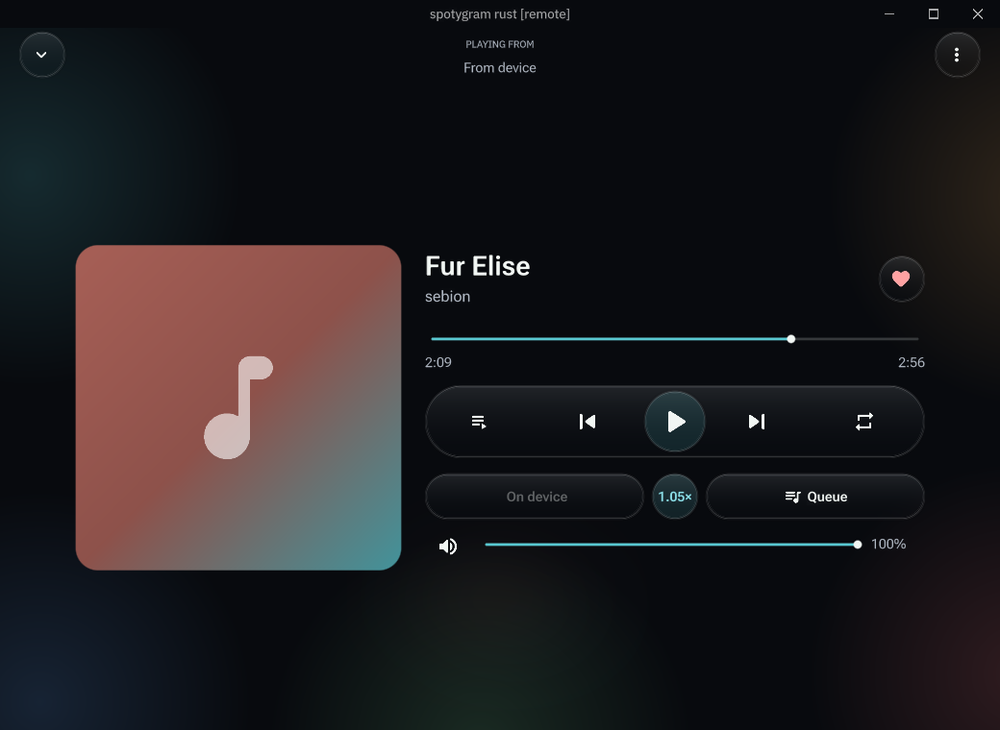

# Использование Rust-версии

[Документация](README.ru.md) · [English](usage.md) · **Русский**

Установи пакет из предварительного релиза **rust-v**, а не обычного latest.
Android использует `app.spotygram.rust` и устанавливается рядом со стабильным
Spotygram. Компьютерные пакеты переносимые: распакуй весь архив и сохрани ресурсы
и нативные библиотеки рядом с программой. Подробнее — [установка](../README.ru.md).

## Твоя библиотека

У тестовой версии отдельные локальная библиотека и сессия Telegram. **Импорт
аудиофайлов** работает без Telegram. Android открывает системный выбор файлов;
Android также принимает аудио через «Поделиться» другого приложения; на компьютере
работают перетаскивание, аргументы запуска и Ctrl/⌘+O.
Импорт создаёт принадлежащую приложению копию, читает теги и обложку.

**Настройки → Подключить Telegram** предлагает номер телефона и QR. Введи номер
с кодом страны. Способ доставки кода выбирает Telegram; он также может потребовать
пароль или почту. Доступность повторной отправки зависит от Telegram. Изменить
номер возвращает к его вводу; закрытие панели позволяет слушать локальную музыку.

**Один аккаунт Telegram означает общие облачные изменения со стабильным Spotygram.**
Избранное, плейлисты, выбранные источники и настройки библиотеки используют тот же
протокол формата 3. Сессии, байты импортов, скачанные копии, очередь, позиции,
громкость и скорость остаются локальными. Для полностью отдельной облачной
библиотеки нужен другой аккаунт. Не копируй активную базу TDLib между работающими
приложениями.

## Источники и подборки

**Источники → Добавить источник → Добавить чаты** ищет доступные чаты и публичные имена. Кнопка папки
переключает папки Telegram, основной список и архив. Выбор чата подключает его;
меню строки отключает. Индексация постепенно читает доступную историю аудио и
документов и продолжает прерванное сканирование. Обновить проверяет подключённые
источники. Поиск библиотеки работает по локальному каталогу.

**Мой профиль** открывает музыку твоего профиля Telegram. **Добавить источник → Добавить профиль**
принимает имя контакта, `@username` или ссылку `t.me`. Просмотр профиля не добавляет
всю его музыку в Музыку. Для этого есть Добавить в библиотеку; отдельные песни
можно сохранить в избранное или плейлист. Видимость музыки определяет Telegram.

Кнопка **В профиль / Убрать** в меню записи сразу изменяет музыку
твоего профиля Telegram. Импортированное аудио сначала загружается; перед действием
об этом есть пояснение. Обычные документы исключены. Нужна связь с Telegram;
локальная запись сохраняется.

Музыка, Любимые и На устройстве могут скрывать повторы без удаления записей.
Сравниваются идентификатор файла, локальный путь или нормализованные название,
исполнитель, длительность и размер. Звуковые данные не сравниваются. Приоритет
имеет отмеченная запись; снятие группового избранного очищает отметки группы.
Явные записи уже созданных очередей и плейлистов сохраняются.

Кнопка **+** в Плейлистах открывает редактор: введи имя, найди и выбери записи,
затем нажми **Создать плейлист**. Поиск сохраняет выбор; записи добавляются
в порядке выбора. **Добавить треки** в меню плейлиста открывает тот же редактор
и исключает уже добавленные записи. Выход с несохранёнными изменениями требует
подтверждения отмены. Создание и начальный состав сохраняются одной транзакцией.

Меню плейлиста также позволяет переименовать или удалить его. В меню записи
доступны изменение состава и Выше/Ниже. Поиск, фильтр источников и сортировка действуют до создания очереди
кнопкой **Слушать всё**.

## Прослушивание и хранение

Нажми запись для воспроизведения. Мини-плеер открывает полный плеер. Нажимай или
перетаскивай шкалу перемотки, меняй скорость и громкость, отключай звук, выбирай
порядок и повтор или открывай Очередь поверх плеера. В её строках есть прямые
кнопки запуска, перемещения выше и удаления, включая несколько вхождений одной песни. Есть прямой и
обратный порядок, перемешивание без повторов внутри прохода и независимый случайный
выбор.

Скорость меняется от 0,3× до 4× с шагом 0,05 ползунком или кнопками −/+. Круглая
кнопка скорости подсвечивается, когда значение отличается от 1×; пресет 1× сбрасывает его.

Состояние плеера сохраняется локально; после запуска музыка сама не включается.
Длинные записи могут продолжаться с закладки; порог длительности задаётся в
Настройках. Android использует медиасервис и уведомление, компьютер — системные
медиакнопки. Esc закрывает панели, Ctrl/⌘+Q завершает приложение. Закрытие окна во
время активной работы сворачивает его; явный выход отменяет эту работу.

**Скачать** сохраняет запись Telegram. Слушать можно до завершения загрузки;
перемотка запрашивает нужный диапазон. Только Wi-Fi относится к явным фоновым
загрузкам. **Не сохранять прослушанное** удаляет подходящие временные копии;
сохранённые загрузки и текущее воспроизведение защищены.

Удаление скачанной копии меняет только локальное хранилище. Удаление импорта
требует подтверждения: оно удаляет копию этого приложения и её облачные отметки
избранного/плейлистов. Исходные внешние файлы и физические копии на других
устройствах остаются. Очистка музыкального кэша сохраняет импорты и требует
подтверждения. **Настройки → Очистить кеш музыки** сначала открывает страницу
с размером аудио и документов. Облачная синхронизация не является резервной копией
или историей правок.

## Отправка и обновления

Выбери **Отправить аудио** в меню записи или полном плеере, укажи разрешённого
получателя и открытую тему форума, если она нужна, затем нажми **Отправить в …**. Один выбор
получателя ничего не отправляет. Перед отправкой повторно проверяются права
Telegram и защита источника. Настройки позволяют сохранять исходные подпись и
отправителя; сохранение отправителя также требует сохранения имеющейся подписи.
Импорты загружаются с сохранением локальной записи. Успех показывается после
подтверждения сообщения Telegram.

Шестерёнка открывает настройки автора и подписи. Кнопка закрепления добавляет
или убирает выбранный чат из быстрого доступа. Недавние получатели появляются
после подтверждённой отправки. Закрепления и недавние получатели локальны
и привязаны к этому аккаунту Telegram.

В Настройках доступны тёмный/светлый вид, выбор системного, русского или английского
языка, управление кешем и
**Проверить тестовые обновления**. Обновление открывает более новый релиз `rust-v` для ручной
установки. Автоматический установщик стабильной версии эта ветка не использует.

Это личный тестовый канал. Фактически пройденные платформы и сценарии аккаунта
указаны в [проверках](verification.ru.md).
