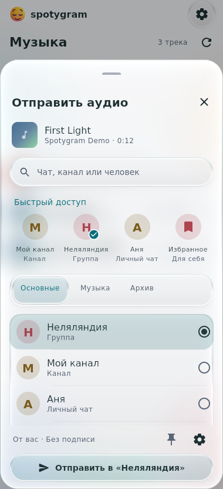
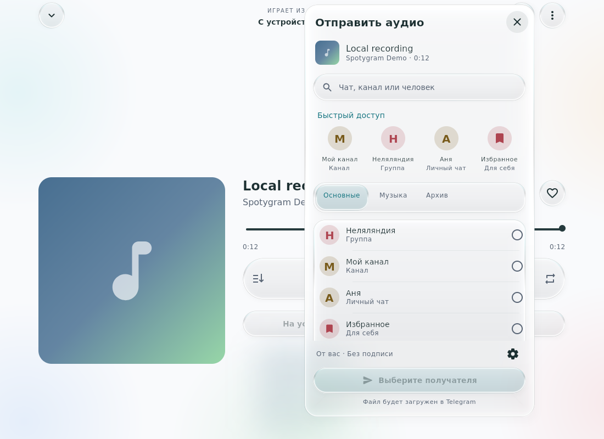
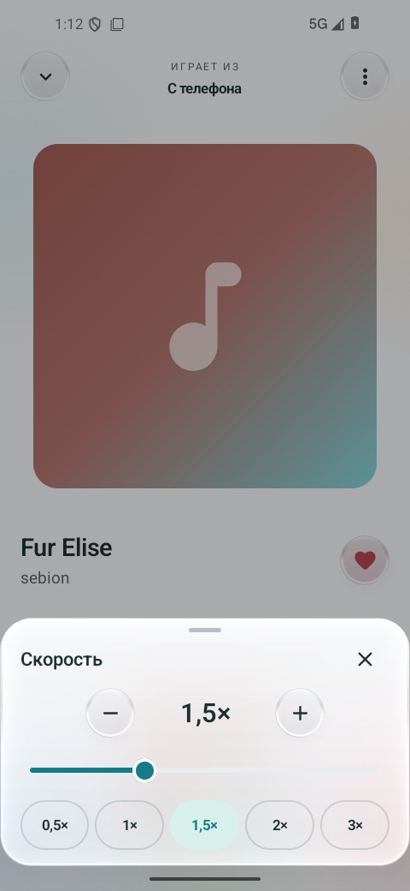
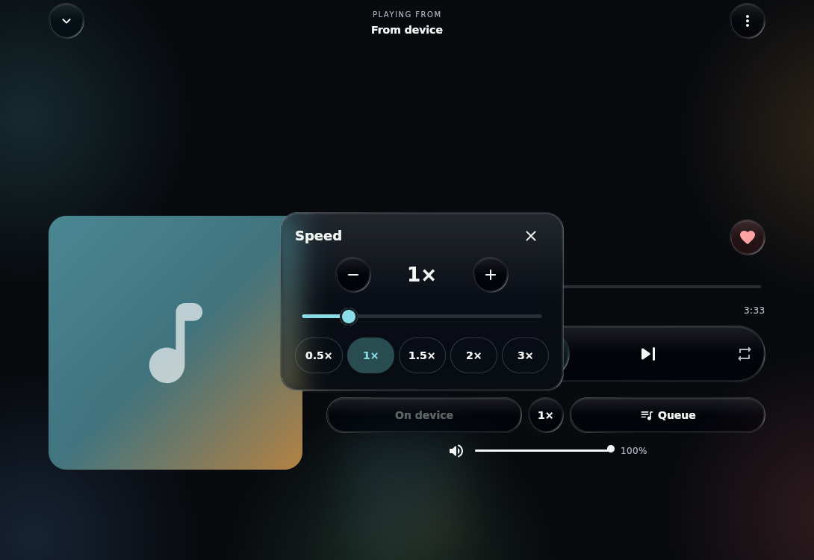

# Как пользоваться Spotygram

[Документация](README.ru.md) · [English](usage.md) · **Русский**

Spotygram играет аудио из чатов Telegram, музыку профилей и локальные файлы.
Любимые, плейлисты и выбранные источники синхронизируются через аккаунт;
копии аудио и воспроизведение остаются на каждом устройстве.

## Первый запуск

На Android установи ARM64 APK из [последнего релиза](https://github.com/Krablante/spotygram/releases/latest).
При установке Android может попросить разрешить установку приложений
из браузера или файлового менеджера. Нужен Android 8.0 или новее.

На Windows установи EXE и запускай из меню «Пуск». На macOS открой DMG и перенеси
Spotygram в Applications. На Ubuntu установи DEB и запускай из меню приложений.
Имена файлов и требования систем есть в [инструкции по установке](../README.ru.md#установить-на-компьютер).
Java и нативные библиотеки уже включены.

Введи номер Telegram в международном формате (`+`, код страны и номер) или
отсканируй QR-код через **Настройки → Устройства → Подключить устройство** в
Telegram. Пробелы, скобки и дефисы допустимы; вместо `+` можно начать с `00`.
API-ключи разработчика для готовых пакетов не нужны.

На экране кода видны номер, который получил Telegram, и выбранный им способ
доставки. Если выбран код в Telegram, проверь служебный чат на устройстве, где
уже выполнен вход с этим номером. Доставкой управляет Telegram: код может прийти
с задержкой или не прийти. Повторная отправка доступна после таймера, если
Telegram предлагает следующий способ доставки. Кнопка указывает SMS или звонок,
когда такой вариант доступен. На пропущенный звонок не отвечай: введи указанное
количество последних цифр номера звонящего. Если код не приходит, перейти к
QR-коду можно прямо с этого экрана. Частые новые запросы могут вызвать ограничения
Telegram. Если включён облачный пароль, введи его после кода.

Ввёл не тот номер? На экране кода, пароля или почты нажми стрелку назад, системную
кнопку назад на Android, Esc на компьютере или **Изменить номер телефона**.
Введи другой номер и нажми **Продолжить**, чтобы запросить код для него.
Если номер неверный, поле остаётся доступным и появляется ошибка.
**Открыть локальную музыку** переводит из входа в локальную библиотеку.

Можно выбрать «Пока без Telegram» и начать с локальных файлов.
**Настройки → Добавить файлы с устройства** открывает системный выбор аудио.
На Android ещё можно поделиться файлом из другого приложения. Desktop принимает
файлы, переданные launcher; **Ctrl/⌘+O** открывает выбор файлов.
Импорт создаёт отдельную копию в библиотеке плеера.

## Добавить музыку из чатов

Открой **Источники → Добавить → Чаты**, выбери «Избранное», группы или каналы
и нажми «Готово». Доступный публичный канал можно добавить по `@имени`.
Spotygram не подписывает тебя на канал автоматически.

Приватные каналы, доступные подключённому аккаунту, можно выбрать по названию —
публичное имя им не требуется. Поиск сразу показывает загруженные чаты,
а затем дополняет их результатами из сети. Ввод не останавливает загрузку
списка; новые чаты могут появляться, пока окно открыто. Для повторной загрузки
и поиска нажми обновление **внутри окна «Добавить источник»**. Без сети уже
загруженные чаты остаются доступны для выбора. Обновление на основном экране
«Источники» пересканирует музыку в ранее выбранных источниках.

Подключённые профили и чаты собраны в отдельные стеклянные панели. В каждой строке
есть аватарка и число треков. Фото используют локальный кэш Telegram; при отсутствии
фото видны инициалы, а у «Избранного» сохраняется закладка. Обновление также повторяет
загрузку видимых аватарок чатов. Нажатие на строку открывает источник. Меню **⋮**
отключает его после подтверждения; любимые, плейлисты и скачанные треки сохраняются.

В «Музыке» кнопка источника показывает **Все источники** или аватарку и название
текущего источника. Открой её и найди источник по имени или `@username` профиля;
нажатие на результат сразу применяет выбор. На узком экране открывается нижняя
панель, на широком — меню рядом с кнопкой. Текущий выбор отмечен и сразу виден
в списке. **Управление источниками** открывает раздел «Источники». Длинные названия
занимают максимум две строки; после открытия источника нажми сокращённый заголовок,
чтобы прочитать и скопировать полное название.

История загружается постепенно: первые песни можно слушать, пока остальные
ещё появляются в списке. Приложение просматривает всю доступную историю,
а не только последние сто сообщений. При обрыве связи загрузка продолжится
с сохранённого места. Обновить список можно кнопкой обновления или жестом
вниз; при незавершённой загрузке доступно её продолжение.

Поиск в библиотеке работает по уже найденной музыке. Если нужной песни
пока нет, кнопка **Поискать в выбранных чатах** запускает поиск в Telegram.
Секретные чаты, голосовые сообщения и видео в музыкальную библиотеку не входят.

## Музыка профилей Telegram

**Источники → Мой профиль** открывает музыку, добавленную в твой профиль Telegram.
Свой профиль всегда наверху, даже если ещё не подключён к медиатеке.
Эта музыка отличается от файлов в «Избранном» или переписке.

Открой меню песни с тремя точками в списке или плеере. Под обложкой и информацией
о песне по центру находится стеклянная кнопка. **В профиль** добавляет песню
в профиль Telegram; **Убрать** удаляет оттуда. Ширина кнопки одинакова в обоих состояниях.
Каждое нажатие сразу выполняет действие, без подменю и подтверждения.
После подтверждения Telegram меню закрывается.
Новая песня появляется в начале музыки профиля. Сообщение о результате предлагает
**Отменить**. Удаление из профиля сохраняет любимые, плейлисты и локальные копии.

Для этих действий нужно соединение с Telegram. При добавлении импортированной записи
файл загружается: пояснение под кнопкой сообщает об этом заранее. Android показывает
тихое уведомление на время загрузки. Исходная локальная запись запоминает загруженный
файл, поэтому кнопка «Убрать» доступна для неё и после перезапуска.
Ограничения Telegram на сохранение записей продолжают действовать. После ошибки
действие можно повторить; приложение не сообщает об успехе до подтверждения Telegram.

Музыка профиля Telegram принимает аудиотреки. Для записей, присланных обычными
документами, эта кнопка не показывается; локальный импорт можно загрузить как аудио.

На узком окне меню открывается снизу. На широком та же шапка и действия появляются
в компактном меню рядом с кнопкой с тремя точками. Кнопка профиля находится внутри
меню и не занимает место среди элементов управления прослушиванием.

Чтобы найти другого человека, открой **Источники → Добавить → Профили** и введи
имя, `@username` или ссылку `t.me/username`. Поиск использует контакты, известные
личные чаты и публичные username; каналы и боты исключены. Недавние профили можно
открыть без повторного поиска. Открытие результата не запускает музыку.

Нажми песню или **Слушать всё**: используется обычный плеер. Список сохраняет
порядок профиля Telegram, а выбранный режим воспроизведения продолжает действовать.
Поиск фильтрует песни этого профиля. Сердечко и меню песни позволяют сохранить
отдельную запись в любимые или плейлист без подключения всего профиля.

**В медиатеку** подключает профиль как постоянный источник. Его песни появляются
в «Музыке», общем поиске и фильтре источников. Нажми **В медиатеке**, чтобы убрать
подключение; любимые, плейлисты, скачанные песни и текущая очередь сохранятся.
Копии прослушанных песен остаются в «На устройстве» согласно настройке кэша и
не добавляют остальные песни профиля в «Музыку» или редактор плейлиста.

Чужая музыка доступна с учётом приватности Telegram. Пустой список может означать
отсутствие песен или скрытую музыку. **Обновить** перечитывает профиль; ошибка или
неполный ответ сохраняют прежний список. Убранные из профиля записи становятся
недоступны для загрузки, но готовые локальные копии продолжают играть. Привязки
файлов восстанавливаются после перезапуска, поэтому искать исходное сообщение
в чате для прослушивания не нужно.

Подключённые профили, любимые и плейлисты используют формат синхронизации 3.
Клиенты до 0.18.0 включительно нужно обновить для продолжения обмена после получения
формата 3; их местная библиотека сохраняется. Новые клиенты читают и прежние форматы.

## Отправить аудио в чат

Нажми кнопку отправки рядом с меню полного плеера или **Отправить аудио** в меню
песни. Выбери получателя и подтверди отправку кнопкой с названием чата. Нажатие
на карточку только выбирает адресата; музыка продолжает играть.

В быстром доступе находятся твои закреплённые адресаты, недавние отправки и
закрепления основного списка Telegram. Выбери чат и нажми кнопку закрепления,
чтобы оставить его рядом. Можно закрепить до восьми получателей; остальные
карточки доступны горизонтальной прокруткой. Основной список, папки Telegram и
архив сохраняют порядок Telegram. Поиск находит чаты, каналы и людей. Открытие
этой панели не подключает источник музыки к медиатеке.

В панели, поиске и быстром доступе видны только адресаты, которым разрешено
отправить этот тип файла. Права на аудио и документы проверяются отдельно;
учитываются право публиковать в канале и личные ограничения участника группы.
Для группы с темами выбери открытую тему. Секретные чаты, адресаты, которым нужна
оплата за отправку, и закрытые темы исключены. Перед отправкой права проверяются
повторно.

По умолчанию запись отправляется с твоего аккаунта, без автора пересылки и
исходной подписи. В **Настройки → Отправка аудио** находятся переключатели
**Сохранять автора пересылки** и **Сохранять подпись**; настройки доступны и
через шестерёнку в панели отправки. Оба пункта изначально выключены. Название
и исполнитель сохраняются, сам аудиофайл не меняется. Telegram не позволяет
убрать существующую подпись, сохранив автора пересылки: панель объясняет это
сочетание до отправки. Публикации в канале следуют правилам авторства Telegram.
Группы, в которых нельзя использовать твой личный аккаунт, исключены.

Записи Telegram используют существующий файл. Локальный импорт загружается:
пояснение перед кнопкой сообщает об этом заранее. Исходная локальная запись и
файл остаются, а ссылка на загрузку сохраняется для следующих отправок.
Защита Telegram от копирования и пересылки действует и при наличии копии для
прослушивания на устройстве.

После подтверждения Telegram появляется сообщение с действием **Открыть**.
При сбое отправки получатель остаётся выбранным для повторной попытки; отзыв права
сбрасывает выбор. Закрытие панели
сохраняет активную отправку: Android показывает тихое уведомление, а desktop
продолжает работу. Настройки отправки, закрепления и недавние получатели
относятся к этому устройству; история адресатов хранится отдельно для каждого
аккаунта Telegram.

Общий интерфейс в узком и широком окнах Linux, с демонстрационными записями
и адресатами.

## Слушать

**Настройки → Скрывать дубли** включено по умолчанию. В «Музыке», «Любимых»
и «На устройстве» повторяющиеся записи показываются одной строкой. Выключи
переключатель, чтобы снова видеть отдельные записи. Ничего не удаляется.

Совпадением считается один файл Telegram, общий локальный путь либо одинаковые
название, исполнитель, длительность и размер файла. Регистр и лишние пробелы
не учитываются; одного названия недостаточно. Содержимое файлов не сравнивается,
поэтому это не распознавание музыки на слух. Поиск и источник применяются до
группировки; из подходящих копий предпочитается сохранённая локальная.

Сердечко учитывает любимые среди всех дублей. Снятие сердечка убирает их вместе,
а «Отменить» восстанавливает прежние отметки. Новая очередь из списка получает
по одному представителю каждой группы. Готовые плейлисты и текущая очередь
не переписываются; в режиме абсолютного рандома повторные случайные выборы
по-прежнему возможны.

Четыре раздела внизу — **Музыка**, **Любимые**, **Плейлисты**, **Источники**.
Приложение запоминает последний открытый раздел. Нажатие на песню начинает
воспроизведение; нижняя панель открывает полный плеер. Управлять музыкой
можно с экрана блокировки Android и через системное медиоуправление компьютера.
На широком окне навигация переходит в боковую панель.

На desktop **Esc** закрывает текущую панель или плеер. Закрытие окна во время
воспроизведения, скачивания, отправки аудио или изменения музыки профиля скрывает его в трее, а при отсутствии трея
сворачивает. **Ctrl/⌘+Q** завершает приложение и сохраняет состояние. После
повторного входа музыка не запускается автоматически.

В мини-плеере есть кнопки предыдущего трека, паузы/воспроизведения и следующего
трека. «Назад» здесь сразу переключает песню, не открывая полный плеер.

Если после возвращения плеер ещё подключается, выбранная песня начнёт играть
после подключения. При нескольких нажатиях учитывается последний выбор.
Если подключиться не удалось, сообщение предложит нажать на песню для повтора;
перезапуск приложения для этого не требуется. Уход из приложения отменяет
ожидающий запуск, но уже играющую музыку не останавливает.

В плеере доступны перемотка, очередь и повтор. Кнопка порядка слева от
«Предыдущий трек» открывает четыре варианта с отметкой текущего. Тот же выбор
есть рядом с «Слушать всё» над подборкой и в пункте **Порядок воспроизведения**
меню песни. Выбор режима в меню не запускает эту песню.

| Режим | Как выбирается следующая песня |
| --- | --- |
| По порядку | Следующая запись в подборке |
| В обратном порядке | Запись выше текущей песни в выбранном списке |
| Перемешивание | Случайный порядок без повторов внутри одного прохода |
| Абсолютный рандом, значок кубика | Каждый раз независимый выбор; возможны повторы даже подряд |

Для списка 1, 2, 3, 4 выбор третьей песни в обратном режиме даёт 3 → 2 → 1.
**Слушать всё** начинает с последней доступной песни. Смена режима сохраняет
текущую песню и позицию. Библиотека и сохранённый порядок плейлиста остаются
прежними; очередь показывает реальный порядок воспроизведения. **Слушать следующим**
ставит песню сразу после текущей, а стрелка вверх в очереди переставляет её
по отображаемому порядку.

В рандоме музыка играет, пока не остановишь её. «Назад» возвращает к недавно
прослушанным песням, а очередь показывает подборку для выбора и ближайшую
следующую запись. Это не расписание проигрывания всей подборки.
**Слушать следующим** в меню трека имеет приоритет над случайным выбором.

Повтор одного трека доступен во всех режимах. Повтор всей подборки —
в прямом, обратном и перемешанном порядке; рандом и так бесконечный.
После перезапуска восстанавливаются очередь и позиция, но музыка сама
не включается.

Нажми круглую кнопку скорости между **Скачать** и **Очередь** в полном плеере.
В широком окне откроется компактная панель рядом с кнопкой. На узком экране —
нижний лист, который можно закрыть перетаскиванием вниз.
Ползунок работает от **0,3× до 4×**, а **− / +** меняют темп на 0,05×.
Быстрые значения — 0,5×, 1×, 1,5×, 2× и 3×. Изменения применяются сразу,
без подтверждения; панель закрывается крестиком, кнопкой «Назад» или нажатием
снаружи.

Высота голоса сохраняется. Выбранный темп действует и для следующих песен,
в том числе после перезапуска приложения. **1×** возвращает обычную скорость.
При другом значении кнопка получает лёгкий акцент, а мини-плеер показывает темп.

На desktop под кнопками скачивания, скорости и очереди есть **громкость 0–100%**.
Динамик после «Следующий трек» в мини-плеере открывает тот же регулятор в небольшой
панели. Нажатие на динамик внутри выключает звук и возвращает прежний уровень.
Перетаскивай ползунок, используй стрелки клавиатуры, когда он в фокусе, или крути
колесо мыши над ним. Изменения применяются сразу к звуку самого Spotygram.

Громкость и выключенный звук сохраняются после перезапуска на этом компьютере.
Порядок, повтор и скорость тоже остаются на каждом устройстве; их изменение
не отправляет документы синхронизации библиотеки.

## Продолжить длинную запись

**Настройки → Запоминать позицию** включено по умолчанию для
записей **от 30 минут**. В пункте **Порог длительности** можно задать
своё целое число минут больше нуля. Порог относится к исходной длительности,
независимо от скорости воспроизведения. Записи ровно на границе тоже подходят.

У каждой записи библиотеки своя позиция. Выбор из музыки, плейлиста или очереди,
а также возврат кнопками «Назад» и «Вперёд» продолжают её с этого места. Пауза
и перемотка обновляют позицию; фоновое воспроизведение тоже периодически её
сохраняет. При повторном входе очередь восстанавливается без автозапуска.
Для коротких треков сохраняется прежнее восстановление текущей очереди,
а новый выбор трека начинает его с начала.

Дослушанные записи и циклы повтора одного трека начинаются заново. Чтобы
начать незавершённую запись сначала, передвинь ползунок к началу или нажми
«Назад» в полном плеере, когда прошло больше трёх секунд. Смена порога и
отключение функции оставляют прежние позиции для дальнейшего использования;
при отключённой функции новые не сохраняются. Дослушивание всё равно сбрасывает
старую позицию. Удаление скачанной копии Telegram сохраняет место остановки,
а удаление записи из библиотеки или выход из аккаунта удаляют связанные позиции.

Во время воспроизведения сохранение происходит примерно раз в пять секунд,
а при паузе, перемотке и смене трека — сразу. При внезапном завершении процесса
можно потерять прогресс после последнего завершённого сохранения. Если длительность
неизвестна, запись начинает подходить после того, как плеер узнает её длину.
Позиции относятся к этому устройству. Пауза, перемотка и смена записи сохраняют
их локально, не отправляя данные воспроизведения в Telegram.

## Любимые и плейлисты

Сердечко справа от песни добавляет её в **Любимые**. Повторное нажатие
снимает отметку; это действие можно отменить в появившемся сообщении.
Файл остаётся на месте, воспроизведение не прерывается.

В **Плейлисты → Новый плейлист** введи название и выбери песни. Можно
создать пустой плейлист, а затем наполнить его кнопкой списка с плюсом
рядом с воспроизведением (**Добавить треки**).

Чтобы добавить несколько песен сразу, зажми одну из них или нажми
значок списка с галочками справа от кнопок воспроизведения (**Выбрать**).
Дальше нажатия отмечают песни, а не запускают их. Поиск
не сбрасывает уже выбранное. «Назад» сначала выходит из выделения.

Меню плейлиста открывается кнопкой действий или долгим нажатием. В нём
можно переименовать плейлист, удалить его или выбрать **Изменить порядок**.
Для перестановки зажми ручку справа от песни и перетащи; есть и стрелки
вверх/вниз. Удаление плейлиста или песни из него не удаляет сами аудиофайлы.

## Общая библиотека на устройствах

Войди в один Telegram-аккаунт на каждом устройстве. Spotygram автоматически
создаёт или находит приватный канал с названием `spotygram-` и случайным
окончанием, отключает уведомления и отправляет его в архив Telegram.
В списке музыкальных источников его нет. Выбирать файлы или запускать
синхронизацию вручную не нужно.

Автоматически переносятся плейлисты и порядок песен, любимые, выбранные чаты и профили,
настройки библиотеки, оформление и язык. У каждого устройства свои очередь,
последний трек и позиции прослушивания. Само воспроизведение не отправляет документы
синхронизации. Карточки нужных песен появляются до окончания индексации.
Импортированные песни сохраняют место в плейлистах, но их аудио остаётся на
устройстве импорта: одной карточки недостаточно для воспроизведения в другом месте.

Правки сначала сохраняются локально, затем отправляются небольшими пакетами.
Офлайн-правки переживают закрытие приложения и передаются после подключения.
Разные добавления песен сохраняются вместе. Противоречащие правки одного поля
разрешаются одинаково по сохранённым версиям. У названия, настройки или членства
песни в плейлисте остаётся одно итоговое значение. При одновременной перестановке
выбирается один порядок с сохранением параллельных добавлений.
Удалённый плейлист или импортированная запись не возвращаются
из-за правок старого устройства. Ранее созданные отдельные плейлисты сохраняют
свои идентификаторы, даже если названия совпадают.
Синхронизация хранит актуальную библиотеку, а не историю всех правок с возможностью
восстановления. Импортированным аудио и важным локальным файлам нужна отдельная копия.

В канале хранятся актуальный полный снимок и небольшой хвост недавних правок.
При подключении клиент сворачивает этот хвост примерно в течение минуты или при
его росте, затем удаляет заменённые документы. Прерванная очистка продолжается
после восстановления связи. Обнови все устройства до **0.26.0 или новее**, чтобы
получить исправления подтверждения отправки и удаления записей.
Сам формат 3 требует версии 0.19.0 или новее; более старые клиенты при встрече
с ним приостанавливают обмен. Обновление сохраняет локальные данные воспроизведения.

**Настройки → Синхронизация библиотеки** показывает состояние и предлагает
повторную попытку после ошибки. Обмен работает, пока Spotygram запущен и Telegram
подключён; закрытое устройство получает изменения при следующем запуске.
Скачанные файлы, сессии, задания загрузки, курсоры индексации и состояние установки
обновлений относятся к конкретному устройству.

Используется обычная облачная защита Telegram, без отдельного ключа или сопряжения.
Сохраняй канал приватным и доступным. После его удаления новое устройство не
сможет восстановить содержимое; подключённое сохранит локальные данные и покажет
ошибку доступа. Выход из аккаунта очищает каталог Telegram на этом устройстве,
сохраняя общую библиотеку.

## Музыка без интернета

По умолчанию после полной загрузки песня получает значок офлайна и остаётся на устройстве.
Чтобы подготовить музыку заранее, нажми **Скачать** у трека или подборки.
В настройках можно ограничить эти загрузки Wi-Fi и возобновить прерванные.
Ограничение Wi-Fi не относится к обычному прослушиванию.

Значок загрузки рядом с выбором источника включает фильтр **На устройстве**;
подсветка и заголовок «На устройстве» показывают, что он включён. Фильтр показывает
сохранённые локальные файлы, без временного буфера. Если несколько
сообщений ссылаются на один физический файл, он всегда отображается один раз.
При включённом «Скрывать дубли» подходящие отдельные копии тоже объединяются.
Объём в настройках учитывает все сохранённые файлы, включая скрытые копии:
скрытие строк не освобождает место. Поиск и выбор источника могут
дополнительно сузить этот список.

## Слушать, не сохраняя каждую песню

Включи **Настройки → Не сохранять прослушанное**, чтобы использовать временные
копии для прослушивания. По умолчанию режим выключен. Старые локальные файлы,
явные скачивания и импорт сохраняются. У временной копии появляется значок
часов. **Сохранить на устройстве** в плеере или меню песни оставляет эту копию
без повторного скачивания.

Текущий, предыдущий и подготовленный следующий файлы остаются, пока нужны
плееру. Более старые временные копии удаляются, когда их никто не читает.
Для возврата дальше назад могут потребоваться интернет и повторная загрузка.
Telegram всё равно использует временные файлы на диске: это не воспроизведение
только из памяти и не строгий лимит объёма. Если очистка отложена, в настройках
появится повторная попытка. Отключение режима сохраняет оставшиеся копии,
но не возвращает уже удалённые.

## Освободить место

У импортированного файла есть отдельное действие **Удалить импортированную запись**
с подтверждением. Оно удаляет местную копию приложения и убирает запись из любимых
и плейлистов на всех синхронизируемых устройствах. Исходный файл импорта и физические
копии на других устройствах сохраняются. Отмена сохраняет файл и записи библиотеки.

**Удалить с устройства** в меню песни убирает её локальную копию. Сообщение
в Telegram не удаляется. Файлы в рабочем окне плеера или с открытым чтением
удалить нельзя.

**Настройки → Очистить кэш музыки** показывает место, занятое скачанными
аудиофайлами Telegram. Импортированные файлы в эту цифру не входят.

**Очистка удаляет и музыку, специально сохранённую кнопкой «Скачать».**
Временные копии и такие загрузки используют общее хранилище Telegram.
Эта ручная команда удаляет больше, чем автоматическая очистка временных копий.
Перед удалением появится подтверждение «Остановить и очистить»:
воспроизведение и загрузки остановятся, а после очистки будет показан
освободившийся объём.

Любимые, плейлисты, импортированные файлы и вход сохраняются. Для повторного
скачивания нужен доступ к исходному сообщению или аудио профиля: если они больше недоступны,
удалённую копию может не получиться вернуть. Для очистки требуется
подключённый Telegram-аккаунт.

## Язык и оформление

Интерфейс следует языку системы: русский или английский, для остальных
языков — английский. **Настройки → Язык** предлагает русский, английский или
язык системы на всех поддерживаемых платформах. Названия песен и чатов не переводятся.

Шестерёнка открывает настройки. В широком окне это центральная панель: закрой
её крестиком справа сверху, Escape или кликом снаружи. Шапка остаётся видимой
при прокрутке. Стрелка назад и Escape на странице кэша или отправки возвращают
к настройкам. На узком экране остаётся нижний лист с перетаскиванием; у него
тоже есть крестик.
При изменении размера окна открытая панель подстраивает размеры и сохраняет свой
тип. Закрой и открой её снова, чтобы выбрать вид для новой ширины окна.

В настройках можно выбрать светлое или тёмное оформление. До выбора приложение
следует настройке системы.
Переключение не останавливает музыку.

Маленький стикер рядом с `spotygram` выбирается из 40 жёлтых жестов и лиц.
Новый запуск приложения или возврат после 30 минут отсутствия выбирает следующий
без повтора предыдущего. Короткие возвраты, смена вкладок, темы или языка и поворот
телефона сохраняют знак. Лица — случайное украшение, а не состояние подключения
или воспроизведения. Стикеры работают без интернета и остаются на каждом устройстве.

Иконка приложения и экраны приветствия/входа используют фото розового плюшевого
Такопи. Системная иконка помещает целую игрушку на светлую тонированную подложку,
а при входе фото показано с прозрачным фоном. Этот образ независим от стикера библиотеки.

## Обновления и сохранность данных

Автоматическая проверка включена по умолчанию. Она происходит только при
открытии или возврате в приложение, не чаще раза в сутки. Ошибка проверки
тоже считается попыткой. Когда новой версии нет, приложение молчит.

В строке с новой версией есть **Скачать и установить**. Такая же кнопка
доступна в настройках. Крестик скрывает напоминание именно об этой версии;
предложение остаётся в настройках. Там же можно выключить автоматику или
нажать **Проверить обновления**.
Повторная ручная попытка доступна не чаще раза в минуту, при ограничениях
GitHub — позже. Предварительные релизы не предлагаются.

После нажатия системный DownloadManager скачивает APK для устройства.
В приложении видны прогресс и отмена; загрузка может продолжаться при закрытом
Spotygram. Когда вернёшься, приложение подхватит её состояние.

Перед установкой проверяются размер, SHA-256, пакет, версия и подпись APK.
Если Android попросит разрешить установку из Spotygram, включи разрешение
и вернись назад — приложение продолжит установку. Отказ не вызывает повторных
окон: можно вернуться к кнопке **Установить обновление** позже. Саму установку
всё равно подтверждаешь в системном окне Android.

Готовый APK можно установить повторно без скачивания или удалить кнопкой
в настройках. При отмене загрузки временные файлы удаляются; после успешного
обновления APK очищается при следующем открытии приложения. Ссылка
**Открыть релиз** остаётся для просмотра изменений на GitHub.

Установленный desktop скачивает подходящий EXE, DMG или DEB, проверяет digest
и подпись релиза. **Закрыть и открыть установщик** передаёт пакет системе. Заверши
установку, затем запусти Spotygram обычным способом. На Linux нужен установщик
программ, связанный с DEB; альтернатива — `sudo apt install ./ФАЙЛ.deb` для скачанного пакета.

Windows-версиям MSI 0.15.2–0.15.4 один раз нужен ручной запуск свежего EXE из
[Releases](https://github.com/Krablante/spotygram/releases/latest). Запускай его
в той же учётной записи Windows: он удалит старый MSI и сохранит профиль.
Следующие обновления устанавливаются из приложения обычным способом.

Переносная копия скачивает подписанный архив и проверяет его содержимое.
Готовая загрузка предлагает подтвердить перезапуск. Приложение закрывается,
заменяет свои файлы и открывается с теми же данными, на паузе. Папка должна быть
доступна для записи; если настройки сообщают обратное, перенеси всё приложение
в свою папку. Скрытие окна сохраняет загрузку. После полного выхода прерванная
загрузка продолжается при следующем запуске, а отмена удаляет её.

**Открыть сообщение в Telegram** использует обычную ссылку на сообщение, когда
она доступна. Личные переписки на desktop открываются в Telegram Web K;
для просмотра выбранного сообщения войди там в тот же аккаунт.

Автоматика предлагает обновление, но сама не запускает скачивание или установку.
Установка нового официального APK поверх старого сохраняет данные. **Удаление приложения Android
удаляет его библиотеку и настройки.** На Windows удаляй Spotygram через
**Настройки → Приложения**, на macOS перенеси приложение в Корзину, на Ubuntu
используй менеджер программ или `sudo apt remove spotygram`. Удаление desktop
сохраняет отдельный пользовательский профиль, импортированную музыку и вход.
Удаление переносной папки программы имеет тот же эффект. Отправленные в Telegram
изменения библиотеки возвращаются после входа, в том числе после переустановки Android.

Вход создаёт полноценную сессию Telegram, а не доступ только к выбранным
чатам. Завершить её можно в разделе устройств официального Telegram.

## Где находятся данные

Desktop хранит профиль отдельно от папки программы:

| Система | Профиль |
| --- | --- |
| Windows | `%LOCALAPPDATA%\Spotygram` |
| Linux | `$XDG_DATA_HOME/spotygram`, либо `~/.local/share/spotygram`, если переменная не задана |
| macOS | `~/Library/Application Support/Spotygram` |

В профиле находятся `library.db`, `imports/`, `preferences/` и `telegram/`.
Обновления скачиваются в системную папку кэша. На Android данные находятся
в приватном хранилище приложения; системное резервное копирование отключено,
а удаление приложения удаляет и данные.

Для резервной копии desktop-профиля сначала заверши Spotygram, затем скопируй
весь профиль в приватное хранилище. Восстанавливай в прежний путь при закрытом
приложении. Ключ базы Telegram остаётся в системном хранилище учётных данных
и не входит в копию этой папки. Поэтому такая копия не переносит сессию Telegram
на другой компьютер и не восстанавливает её при потере системного ключа.
Сохраняй и оригиналы импортированных файлов: синхронизация не загружает их аудио.
`SPOTYGRAM_STATE` задаёт файлы сборки для разработчика,
а не расположение пользовательского профиля.

## Если что-то не работает

| Проблема | Что сделать |
| --- | --- |
| Windows-версия 0.15.2 не создаёт базу Telegram | Установи свежий релиз поверх неё. Сохрани `%LOCALAPPDATA%\Spotygram` и ключ в системном хранилище. Исправление создаёт недостающие папки Telegram. |
| При удалении Windows повторяет ошибку прав на файл в `Config.Msi` | Закрой зависший установщик и запусти свежий EXE по инструкции ниже. Он заменит старый MSI собственным деинсталлятором. |
| Вход в Telegram на Linux сообщает об ошибке хранилища ключей | Запусти и разблокируй Secret Service: например, GNOME Keyring или KeePassXC с включённым Secret Service. Перезапусти Spotygram и повтори вход. |
| macOS блокирует первый запуск | Используй **Конфиденциальность и безопасность → Всё равно открыть** из [инструкции по установке](../README.ru.md#установить-на-компьютер). |
| Песни нет в библиотеке | Обнови выбранный источник. Если запись ещё не найдена, нажми **Поискать в выбранных чатах**. Убедись, что это аудио или аудиодокумент, а не голосовое сообщение. |
| Прерванное скачивание остаётся на паузе | Проверь сеть и ограничение Wi-Fi, затем возобнови загрузки в настройках. |
| Удаление с устройства сообщает, что аудио используется | Выбери другую подборку, чтобы файл вышел из текущего, предыдущего и следующего рабочего набора плеера. Повтори удаление. |
| Desktop не устанавливает обновление | Установленная копия: заверши системную установку; на Linux проверь открытие DEB или используй `sudo apt install ./ФАЙЛ.deb`. Переносная копия: заверши приложение, перенеси его целиком в папку с доступной для записи родительской папкой, запусти там и повтори установку. |
| Библиотека не открывается | Закрой и снова открой приложение. Сохрани профиль и текст ошибки; не очищай данные ради устранения сбоя. Старая версия приложения не открывает новую схему базы. |

### Windows Installer не удаляет старую версию

Заверши Spotygram и отмени зависшее удаление. Если окно ошибки появляется снова,
заверши именно эту задачу **Windows Installer** через «Диспетчер задач».
Скачай свежий `spotygram-…-windows-x64.exe` из
[Releases](https://github.com/Krablante/spotygram/releases/latest) и запусти его
в той же учётной записи Windows. Мастер удалит старый MSI перед установкой новой
версии. Известные ошибки папки отката обрабатываются без изменения прав на диске.
После установки **Настройки → Приложения → Spotygram → Удалить** запускает новый
деинсталлятор и сохраняет профиль и ключ базы.

Если Windows уже потерял регистрацию старой установки, в поле папки установки
укажи прежнюю папку программы. По умолчанию это `%LOCALAPPDATA%\SpotygramApp`.
Мастер заменит оставшиеся там файлы программы.

Если переход завершить не удалось, мастер остановится и покажет путь к логу
в `%LOCALAPPDATA%\Spotygram\cache\installer`. Сохрани его для диагностики;
перед отправкой просмотри, поскольку в нём есть имя пользователя и пути к файлам.
Сохрани профиль.

Для воспроизводимой ошибки укажи версию приложения, систему, действие и текст
ошибки в [GitHub issue](https://github.com/Krablante/spotygram/issues).
Телефон, сессии Telegram, названия приватных чатов и библиотека не должны попадать
в публичный отчёт. Сбор рабочих логов для разработчика описан в
[руководстве по сборке](build.ru.md#проверять-изменения).
